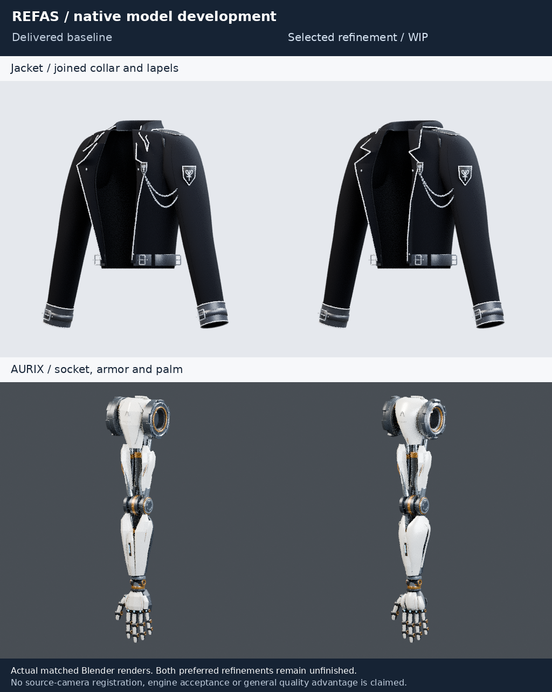

# Joined garment facing and compound automail refinement

Date: **2026-11-22, Asia/Seoul**. Continued development on `rewrite/v2`,
[issue #398](https://github.com/ictseoyoungmin/refas/issues/398) and
[Draft PR #399](https://github.com/ictseoyoungmin/refas/pull/399).

**Both final refinements are preferred to their delivered baselines in isolated
visual comparisons; neither is accepted as a finished match to the complete
original sheet.** The jacket's first refinement tied the baseline. Its later
joined collar/lapel correction received a new, isolated review. The first
candidate, its tied verdict, and every earlier negative comparison remain
available. Runtime consistency defects discovered during development were
reproduced, fixed and covered by actual Blender tests.

Open [the offline comparison viewer](viewer.html), inspect the
[whole-view comparison](preview.png), or read the
[joined jacket report](garment/joined-fold/author-report.md) and
[automail report](automail/README.md). Every displayed model image is an actual
Blender render. The source sheets are unchanged; camera registration to those
sheets is not claimed.

[Download the complete native/GLB delivery](https://chatgpt.com/library?file_id=libfile_969deb1c1dac8191bb96d8af9671df86&account_id=personal).
The 161,783,607-byte archive contains 547 manifest payload entries plus the
manifest. ZIP CRC and every payload size/SHA-256 were verified. It includes
the offline viewer, both baselines, selected/edit/pose models, retained
intermediate selections, source/script snapshots, prompts and review packets.
[The delivery receipt](delivery.json) records its identity; the archive cannot
contain its own subsequently issued download receipt.

## Source, baseline and scope

The user asked to continue development and reattached the original uniform
jacket and AURIX MK-IV sheets. Their SHA-256 identities match the committed
originals. The previous 93,743,833-byte delivery was independently recovered:
ZIP CRC, all 415 manifest entries, sizes, hashes and exact file counts passed.
See [baseline recovery](baseline-recovery.json) and
[current attachments](prompts/attachments.json).

The selected starting native scenes are the ones delivered at `e265a35f`.
No interrupted, unpublished geometry was recovered or attributed to this run.
Initial authoring used the 277-file skill frozen at `94930b3d`; the later joined
jacket correction used the actual extracted current development package.
[The protocol](PROTOCOL.md) separates those activities and their snapshots.

This is informed asset refinement and runtime development. Authors inherit the
prior conversation and receive explicit feedback. It is not a fresh
no-skill/1.x/2.0 comparison, a general model benchmark, or a quality/cost
advantage claim. Exact backend identifiers, tokens and cost were unavailable.
The older control results remain in the [previous evidence](../garment-and-automail/README.md).

## What changed in the models

### Uniform jacket

The first local candidate widened and turned the collar and simplified the
piping, but its anonymous review found new projecting rectangular tabs and
weaker collar continuity. That candidate **tied** the original baseline.
The complete [first author record](garment/author-report.md) and
[literal first review](review/initial-review.md) are retained.

The final correction makes the collar stand, turned leaves and both lapels
one editable cloth-facing mesh. Two 11-edge shared seams connect the lapels to
the collar. The outline now follows one visible notch and long lapel edge.
Width, depth and turn height vary independently; the final design uses a
tapered leaf and an 8 mm outward lapel roll. The body, sleeves, cuffs and
ornaments were protected during this local change.

The former lapel objects are now named vertex groups on
`Collar | standing back and neck facing`: left/right rolled lapels and
left/right shared gorge seams. This is an intentional selection change,
documented in the author report. The facing is still separate from the body.

Six surviving objects change, four targeted objects are removed or merged,
and **261 original object fingerprints plus all six materials remain exact**.
The selected asset has **267 meshes and 418,540 evaluated triangles**, compared
with 302,196 baseline triangles. The denser facing is not an optimization.

The measured back-center construction anchor remains 0.420 m. The source's
nominal 0.58 m sleeve and the inherited 0.607397 m cage meridian are explicitly
different measurements; this continuation does not resolve that ambiguity.

### AURIX automail

The socket now uses stepped axial/radial housings, a recessed bore, nested
rims and shaped locking segments. Forearm shells vary in width and depth
and have distinct lateral profiles. A real curved side opening exposes the
mechanism. The palm gains a closed base and separated dorsal pads; lead
feedback reduced an overly bulbous intermediate and flattened the center pad.

**44 existing objects change; 256 other object records are exact**, with no
added or removed objects. All 20 pivot empties, finger geometry, actuator/rail
structure and the service-cover subtree are preserved. Existing material
datablocks are unchanged; the palm base receives a private graphite copy.

The selected arm contains **300 objects, 280 meshes and 201,632 evaluated
triangles**. Its 743.095 mm evaluated height is unchanged, while the reference
labels total length as approximately 760 mm. Neither this dimension nor
inferred internal depths are presented as calibrated source reconstruction.

## Independent visual findings

Fresh reviewers receive only the complete original sheets and anonymous A/B
whole/detail renders. They receive no author reports, intended fixes, prior
verdicts or condition mappings. Mappings are unsealed only after their literal
reviews are returned. [Mapping records](review/) bind packet images to selected
native identities.

| Comparison | Anonymous verdict after unblinding | Finished visual acceptance |
| --- | --- | --- |
| First jacket refinement vs delivered baseline | Tie; clearer piping traded against weaker collar continuity | Both rejected |
| Final joined jacket facing vs delivered baseline | Final correction preferred, moderate-to-high confidence | Both rejected |
| Final arm refinement vs delivered baseline | Final correction preferred, moderately high confidence | Both rejected |

The [fresh jacket review](review/joined-fold-review.md) prefers its coherent
collar/lapel border and readable notch. Broad planar lapels, a shelf-like rear
collar edge, rigid tailoring, bright strap surfaces and simplified emblems,
pendants and cuff construction remain substantial defects.

The [arm review](review/initial-review.md) prefers the stronger socket/forearm
volume and palm surfaces. Sparse upper-arm mechanisms, broad shoulder
silhouette, simplified smooth armor, schematic fingers/pads and missing
service-area detail still depart from the source. Relative preference is not
finished acceptance or proof that the workflow is generally superior.

## Local edits, restoration and export checks

| Exercise | Jacket, final joined facing | Automail, final selection |
| --- | --- | --- |
| Local change | Wearer-left cuff nominal 6 → 7 cm | 26-node service cover translates 3 mm on local +Y |
| Preservation during local edit | Seven objects changed; 260 unchanged | 274 other objects unchanged |
| Exact selected-bundle restore | All 14 artifacts and captured inputs | All 16 artifacts and captured inputs |
| Independent GLB import | 267 names/parents; 418,540 triangles | 300 names and required parents |
| Largest per-object bounds difference | 1.86e-9 m | 4.25e-9 m |
| Additional motion evidence | None; static garment | Elbow 0/45/90° and elbow 45° + wrist/index sample |

Actual GLB import renders are retained separately from native renders. The
jacket's unchanged body retains two shared 40-edge armholes. The evaluated
body and facing have no boundary/nonmanifold edges or zero-area faces in the
independent check. Of 44 changed arm meshes, 42 non-label meshes are closed;
two inherited lettering meshes retain boundary edges. These findings do not
prove full-object intersection clearance or physical construction.

The arm's sampled pose check finds no triangle-surface intersection among 30
declared shell pairs in each of four saved poses. It excludes containment,
unlisted components, continuous motion, loads and working hydraulics. No skin
rig, cloth simulation, complete UV layout, baked procedural cloth equivalence
or target-engine acceptance is claimed.

## Runtime defects and repair

The old `instance_type` guard missed instances generated by Geometry Nodes.
A native scene could therefore render repeated geometry while its mesh
inventory described only the original object. The new worker checks evaluated
dependency-graph instances and refuses the unsupported scene until the
instances are realized or replaced by explicit mesh objects.

A second gap allowed mesh modifiers with different viewport/render enablement,
or different viewport/render subdivision levels. Inspection/export and the
actual render could then describe different geometry. The worker now rejects
those configurations before outputs are published, without silently changing
the author's settings. This guard is deliberately limited to the tested
visibility/subdivision mismatches; it is not universal equivalence for every
possible view-dependent node setup.

Two regression methods contain eight rejected inspect/edit subcases. All
eight wrongly succeed on the frozen worker and fail their expectations.
They pass with the repaired worker, preserve the original input bytes, and
leave no GLB/PNG on rejection. A realized nine-cube Geometry Nodes case
successfully retains 108 triangles through export and import. See
[raw probes and regression evidence](runtime/README.md).

The repair is published in commit
[`16c57b25`](https://github.com/ictseoyoungmin/refas/commit/16c57b25e20d4263f9ec85206917bbdb8d39fee3).
Its two remote workflows completed successfully. Remote production jobs
without Blender are distinct from the local actual-Blender results below.

## Validation and reproducibility

| Check actually executed | Result |
| --- | --- |
| JavaScript regression | 931 passed, zero failed/skipped |
| Production regression | 37 passed: 23 project/CLI tests + 14 actual Blender tests, zero skipped |
| Python syntax, repository checks, skill validation | PASS |
| Retained 1.x dogfood | PASS, 11 checkpoints; existing claim scope retained |
| Package audit | PASS, 399 files, 43 reference leaves, 68 routed targets; 121 runtime interfaces unchanged |
| Initial jacket clean extracted-package replay | Exact selected scene and GLB; all 14 files restore |
| Final joined jacket workflow from extracted package | 15 commands, including 14 public CLI operations; own 14-file restore and actual GLB import |
| Arm clean frozen-skill replay | Exact selected scene/object records and GLB; cover/four-pose sequence restores all 16 files |
| Arm extracted-package compatibility | Three views, cover edit, own 10-file exact restore, GLB import/orbit checks |

The actual extracted `refas-1.4.2.tgz` is 884,390 bytes with SHA-256
`0b62e372e335cdf090718ee0a3384e5a51b3e48f309d8c7c1e9e0ba8bbf4e01a`.
The package includes both runtime guards and the revised garment/assembly
guides. The shortened arm compatibility run is not credited with the separate
four rendered pose sequence. [Check logs and package manifest](checks/)
retain commands, timing and tested file identities.

Both portable runners were repaired to scope observation projects by selected
revision. The arm runner also reopens an existing scope and appends a guarded
new observation revision. Focused repeat-use checks preserve prior history.
Recorded full-run script hashes are not retroactively replaced by later
runner hashes.

Run [the jacket example](../../../../examples/uniform-jacket/run_fold_refinement.py)
or [the arm example](../../../../examples/automail-arm/run_refinement.py) with
an explicit baseline native, fresh output directory, installed skill root and
Blender executable. Their author reports contain complete commands and
prerequisites. Execution times exclude authoring and review and are not speed
benchmarks.

## Provenance and remaining work

[Literal prompts](prompts/) are saved before dispatch with hashes, roles,
recipients and confirmation times. Authors, later feedback, package checks,
the two isolated reviews and delivery packaging are distinguished. The prior
recovery-time prepared instructions remain an unsent historical draft.

The delivery retains selected native/GLB assets, local edits, sampled poses,
original sheets, fixed observations and compact failed/intermediate model
states with their captured source scripts. Repeated restored model copies,
duplicate replay models and full redundant project histories are omitted from
the compact archive; manifests state exactly what was copied and omitted.

R2-05/06 remain **WIP**. The next visible work is convincing jacket cloth roll,
tailoring and source-specific ornament/strap construction, plus denser and
more articulated source-specific automail armor/mechanisms. Broader reference
evaluation, engine/budget goals, migration and coordinated 2.0 distribution
remain open. Package metadata stays at 1.4.2 development; the published release
remains v1.4.1, and PR #399 remains Draft.
