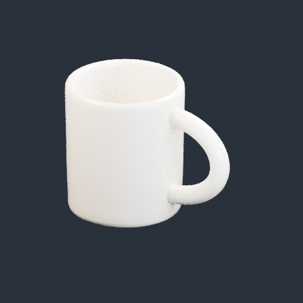

# RefAs 2.0 머그 제작 사용성 fixture 증거

## 기록의 성격과 판정

최초 독립 평가에서는 `SKILL.md`만 읽고 별도 복사본에서 **제작 → 손잡이 국소 수정 → 이전 revision 복구**를 완주했다. 이어 최신 후보로 **같은 corrected fixture의 호환 확인을 한 번** 수행했고 통과했다.

두 단계를 구분한다. 후속 실행자는 이미 최초 결과와 수정 내용을 알고 있으므로, 후속 확인을 새로운 blind 사용성 평가로 간주하지 않는다. 사진 reference는 사용하지 않았다. 사진 충실도나 모델 간 성능 비교에 대한 주장은 하지 않는다.

- 최초 읽은 `SKILL.md` SHA-256: `9ea820ffbb15fca6e40f1018d31d50eeb199c86b94424dad179653231accc0b2`.
- 후속 실행한 `SKILL.md` SHA-256: `e4de3bf4c3e08fc8e2c8092de6a3975be29d2746f36352e9c71fd9b188c7a48a`.
- 후속 후보의 `produce.py` 및 `production/*.py` 해시는 [followup-runtime.json](checks/followup-runtime.json)에 기록했다.
- 최초 보고서와 모든 임시 원본 산출물은 그대로 보존했다. 최초 skill도 별도 snapshot으로 보존한 다음 실행 복사본만 동기화했다.
- 이 공개 증거 폴더에는 보고서, fixture 스크립트, 기계 검사 JSON, 원본 PNG 복사본만 넣었다. native/GLB 전체 bundle은 재현 명령으로 생성한다.

이 문서의 `$REPO`는 저장소 root, `$WORK`는 저장소 밖의 재현 작업 폴더다. 하단 최초 보고서에서는 임시 절대 경로를 이 기호로만 치환했다. 실제 revision ID, 수치, 최초 문서 hash, 실패·경고 이력은 유지했다. 하단의 “최종” 및 개선 요청은 **최초 평가 시점**을 가리킨다.

## 후속 후보 호환 확인

| 작업 | revision ID | 실제 실행 |
|---|---|---|
| 제작 | `110c72f26b4b4d16a2e421509aa0d4c6` | run `6cf60c556bbd4a31a96929b4eab61d6c`, 4.276초 |
| 개구부 확대 | `b1f5cfe5c9c742538d772320b514e8e4` | run `32f162f8ec3f4113b2207dc792b64f06`, 4.483초 |
| 제작본으로 복구 | `2ffbd63a3f194b47be3ce28033066c72` | 새 revision, sequence 3 |

실제 Blender 4.3.2로 동일한 corrected create/edit 스크립트를 실행했다. 별도 Blender 프로세스가 세 native 파일을 다시 열어 검증한 [followup-native.json](checks/followup-native.json)의 여덟 검사가 모두 참이다.

- 몸체 geometry/transform/재질 슬롯과 material node 입력·연결 hash가 세 revision에서 동일하다.
- 손잡이 개구부의 실제 가운데 폭은 0.80125007 → 1.00625011, 약 25.59% 커졌다.
- 복구된 native, GLB, scene/result metadata, hero, side 여섯 파일이 최초 제작과 바이트 단위로 같다.
- 두 mesh 구성물은 non-manifold edge가 0이며 signed volume이 양수다.
- 실제 native reopen과 GLB reimport 검사가 통과했고 최종 `verify`는 `ok: true`, 6 artifacts다.

### 최초 사용성 지적에 대한 후속 확인

`run` 및 `status`에서 `observations`의 PNG 절대 경로와 `inputs/edit.py` 경로가 노출됨을 확인했다. 수정 run은 `inputs/base.blend` 경로도 노출하며 실제 파일 존재 여부를 검사했다. `run --help`에 `front(-Y),back(+Y),side(+X),top(+Z)` 및 `bbox-framed`가 표시된다. 따라서 최초 보고서의 경로 발견성과 축/자동 framing 안내 지적은 이번 후보에서 보완된 것으로 확인했다.

이 fixture에는 static modifier, dirty packed texture, hidden/excluded helper가 없다. 해당 별도 수정은 **이번 후속 실행의 검증 범위 밖**이다. 이 호환 확인은 root의 전체 테스트를 대신하지 않는다.

### 실제 전후 hero 렌더

아래 파일은 후속 후보의 실제 Blender PNG를 **바이트 그대로 복사**한 것이다. 합성, annotation, resize, 색 보정은 하지 않았다. 원본 revision과 SHA-256은 JSON에 기록했다. 각 생성 run의 hero/side를 직접 열어 확인했다. 16 samples의 diagnostic render이므로 미세한 noise가 있다. bbox 자동 framing으로 전후 카메라 scale이 약간 다르며 몸체 보존 판단은 native 데이터 비교에 기반한다.

| 제작 직후 | 손잡이 개구부 확대 후 |
|---|---|
|  |  |

## 재현 명령

저장소 root에서 실행한다. 생성물은 새 작업 폴더에 기록된다. `create_mug.py`와 `enlarge_handle.py`는 최초 corrected fixture 및 후속 run에서 사용한 파일과 바이트가 같다. `check_native.py`는 기존 검사 로직을 유지하면서 project root, 세 revision, output 경로만 인자로 받도록 한 스크립트이며 후속 실행에서 실제 사용했다.

```bash
REPO="$(pwd)"
EVIDENCE="$REPO/docs/development/evidence/refas-2-mug"
WORK="$(mktemp -d -t refas-mug-repro.XXXXXX)"
cp -a "$REPO/skills/refas" "$WORK/skill"
S="$WORK/skill/scripts/produce.py"
P="$WORK/project-final"
python3 "$S" doctor
python3 "$S" run --help
python3 "$S" init --root "$P" --name ceramic-mug
python3 "$S" run --root "$P" --script "$EVIDENCE/scripts/create_mug.py" --intent 'Final-candidate compatibility follow-up: build the same corrected mug fixture' --views hero,side --size 512 --samples 16 --timeout 120 --expected-revision none > "$WORK/build.json"
BASE="$(python3 -c 'import json,sys; print(json.load(open(sys.argv[1]))["head"])' "$WORK/build.json")"
python3 "$S" run --root "$P" --script "$EVIDENCE/scripts/enlarge_handle.py" --intent 'Final-candidate compatibility follow-up: enlarge handle opening and preserve body' --views hero,side --size 512 --samples 16 --timeout 120 --expected-revision "$BASE" > "$WORK/edit.json"
EDIT="$(python3 -c 'import json,sys; print(json.load(open(sys.argv[1]))["head"])' "$WORK/edit.json")"
python3 "$S" verify --root "$P"
python3 "$S" restore --root "$P" --revision "$BASE" > "$WORK/restore.json"
RESTORE="$(python3 -c 'import json,sys; print(json.load(open(sys.argv[1]))["head"])' "$WORK/restore.json")"
/usr/bin/blender -b --factory-startup --python "$EVIDENCE/scripts/check_native.py" -- --root "$P" --revisions "$BASE" "$EDIT" "$RESTORE" --output "$WORK/native-checks.json"
python3 "$S" verify --root "$P"
python3 "$S" status --root "$P"
```

새로 재현하면 새 revision ID가 생성된다. 원래 실행의 IDs는 위 표에 보존되어 있으며, command의 intent/options 및 검사 방법은 동일하다. 확인한 변경 범위는 이 evidence 폴더뿐이며 core, Git, Notion에는 손대지 않았다.

## 포함 파일

| 자료 | 내용 |
|---|---|
| [create_mug.py](scripts/create_mug.py) | 닫힌 머그 몸체와 둥근 손잡이를 생성하는 corrected fixture |
| [enlarge_handle.py](scripts/enlarge_handle.py) | 기존 손잡이 정점만 수정하고 몸체 signature를 검사 |
| [check_native.py](scripts/check_native.py) | 세 native reopen, geometry/material/개구부/복구 바이트 검사 |
| [initial-independent-native.json](checks/initial-independent-native.json) | 최초 독립 평가 corrected cycle의 원본 검사 결과 |
| [followup-native.json](checks/followup-native.json) | 후보 호환 cycle의 원본 검사 결과 |
| [followup-runtime.json](checks/followup-runtime.json) | 도구 출력 기반 실행·경로·reimport 검사, 후보/스크립트/PNG hash |
| `before-hero.png`, `after-hero.png` | 후속 후보의 실제 원본 hero PNG |

기계 JSON 중 두 native 검사 파일은 원본을 그대로 복사했다. Runtime 요약 JSON은 실제 출력에서 추출했으며 로컬 작업 경로 prefix만 `$WORK`/`$REPO`로 정규화했다. 경로가 실제 absolute였고 존재했는지는 원본 출력으로 검사한 boolean에 보존되어 있다.

---

## 최초 독립 평가 기록 — 경로 정규화본

### 판정

**요청한 제작 → 손잡이 국소 수정 → 이전 revision 복구 경로 통과.** 복사본만 실행했고, 스킬 runtime은 수정하지 않았다. 실제 Blender 4.3.2에서 editable native, GLB, hero/side 렌더를 생성했다. 손잡이 안쪽 개구부가 커지는 동안 몸체 geometry/material이 보존되었으며, 복구는 이전 bundle의 여섯 artifact를 바이트 단위로 재현했다.

이 판정은 단순 정적 머그 fixture에 대한 실행·사용성 판정이다. 실사진 충실도, 게임엔진 적합성, 제조용 단일 solid 인증은 평가하지 않았다.

### 독립성 및 환경

- 읽은 제작 지침: 원본 `SKILL.md` 한 파일. 기존 audit나 다른 테스트 결과는 읽지 않았다.
- 원본 위치: `$REPO/skills/refas`.
- 실행 복사본: `$WORK/skill`.
- 복사본 `SKILL.md` SHA-256: `9ea820ffbb15fca6e40f1018d31d50eeb199c86b94424dad179653231accc0b2`.
- 의도적으로 작성한 파일은 모두 `$WORK` 아래에 있다. repo, Notion, GitHub, 설치/배포 상태를 변경하지 않았다.
- 실제 doctor 결과: Python 3.12.14, `/usr/bin/blender`, Blender 4.3.2; `ok: true`.
- 초기 fixture에 면 방향 오류가 있어 **제작자 자신의 modeling script만** 수정했다. 그 이전 실행 기록도 보존했으며 아래에 별도 기술한다.

### 최종 검증 cycle

| 단계 | 실제 revision ID | run ID / 결과 |
|---|---|---|
| 최초 제작 | `6333aff2202647c0a265f844519f1493` | `b710c2a5630a4c568e7dc99722f68b37`, 5.046초, 성공 |
| 손잡이 수정 | `18882a8b98a0469684d51e12725166e6` | `546297a764fc47e59f1e4299818b3bdc`, 4.640초, 성공 |
| 최초 제작으로 복구 | `75da7fbfe9fa4c54a93aa505557e79b9` | 새 revision 생성, 이전 두 revision 보존, 성공 |

현재 head는 `75da7fbfe9fa4c54a93aa505557e79b9`, sequence는 3이다. 두 생성 run 모두 `--expected-revision`을 지정했다. 복구 전후 `verify` 성공, 최종 `artifactCount: 6`, `incompleteRuns: []`.

#### 모델 구성 및 수정 내용

`MugBody`는 바닥과 내부가 있는 닫힌 회전체 mesh이며, `MugHandle`은 몸체 양 끝에 겹쳐 연결된 원형 단면의 C자 곡면 mesh다. 두 개체는 분리해 편집 가능하다. 단색 Principled BSDF 세라믹 재질을 공유한다. 외부 texture 의존성은 없다.

수정 스크립트는 기존 손잡이 정점 좌표만 바꾸며 arc span을 1.02 → 1.18, tube radius를 0.17 → 0.125로 바꿨다. 접합 중심, 반높이, 몸체, 재질은 유지했다. 개구부 가운데 높이에서 실제 mesh의 안쪽 X 경계와 몸체 표면 사이를 측정한 폭은 **0.80125007 → 1.00625011**, 약 **25.59% 증가**했다. 복구 후에는 0.80125007로 돌아왔다. 단위는 fixture 좌표 단위이며 실물 치수 인증은 아니다.

#### 기계 검증

`check_native_corrected.py`가 세 `.blend` 파일을 실제 Blender로 다시 열고 독립적으로 비교했다. 저장된 runtime metadata만 믿는 방식이 아니다.

| 검사 | 실제 결과 |
|---|---|
| 몸체 geometry/transform/name/part ID/재질 슬롯 보존 | 세 revision SHA-256 동일 |
| 몸체 material의 node 타입·입력값·연결 보존 | 세 revision SHA-256 동일 |
| 손잡이 geometry 변경 | 제작 ≠ 수정 |
| 손잡이 geometry 복구 | 제작 = 복구 |
| 실제 정점 기반 개구부 확대 | 통과 |
| 모든 구성 mesh non-manifold edge | 0 |
| 구성 mesh signed volume | 모두 양수 |
| 복구 native/GLB/scene metadata/result/hero/side | 모두 원본과 바이트 동일 |
| `produce.py verify` | `ok: true`, 6 artifacts |

몸체 geometry hash: `5808ae2ac38b26afe15546637ffc3d81650dd6a1bc5d3962c7f386cbbb00ce74`.

몸체 material hash: `d1676240852b12ff81fb1256a0e61f81d2b201cce0c75af8cd9771f74164e08b`.

몸체 3,586 vertices, 3,712 faces; 손잡이 2,330 vertices, 2,352 faces. GLB 2 meshes, 1 material, 11,824 triangles. Runtime의 실제 native reopen fingerprint 검사와 GLB reimport 검사도 모두 `passed`다. GLB reimport에서 native와 triangle 수·bounds가 일치하고 diagnostic camera/light는 export에 포함되지 않았다. 엔진 실행 검증을 의미하지는 않는다.

#### 실제 렌더의 육안 확인

각 생성 revision의 `view-hero.png`와 `view-side.png`를 `view_image`로 직접 열었다. 복구된 hero도 다시 열었다. 모두 512×512 Cycles CPU, 16 samples의 실제 Blender 출력이다.

- Hero에서는 빈 컵 내부, 둥근 림, 둥근 손잡이와 양쪽 접합을 확인했다. 수정 렌더에서 손잡이가 더 얇고 외측으로 확장되어 안쪽 공간이 넓어졌다.
- 기본 side는 +X 쪽에서 보기 때문에 이 fixture의 손잡이를 edge-on으로 보고 개구부가 몸체에 가려진다. 요청한 side 산출 자체는 정상이나 개구부 판정에는 hero가 더 유용했다.
- 16 samples라 미세한 noise가 남아 있으며 밝은 diagnostic 조명에서는 재질이 흰색에 가깝게 보인다. 제품용 최종 홍보 render로 평가하지 않았다.
- 몸체 형상은 데이터상 같지만 자동 framing으로 카메라 orthoScale이 5.32501936 → 5.42186117로 변했다. 따라서 두 렌더의 픽셀 차이를 몸체 변경 증거로 사용하지 않았다.

### 실행 명령과 산출 로그

아래 경로는 실제 실행한 복사본과 프로젝트다. 긴 명령에서는 표기만 줄이기 위해 `B`, `S`, `P`를 썼다. 아래 변수 치환 후의 명령과 동일한 absolute-path 명령을 실행했다. modeling/check 스크립트 전체는 해당 파일로 보존되어 있다.

```bash
B=$WORK
S=$B/skill/scripts/produce.py
P=$B/project-corrected

cat $REPO/skills/refas/SKILL.md
mkdir -p $WORK
cp -a $REPO/skills/refas $WORK/skill
python3 "$S" doctor
python3 "$S" run --help
python3 "$S" init --root "$P" --name ceramic-mug
python3 "$S" run --root "$P" --script "$B/build_mug_corrected.py" --intent 'Build complete editable ceramic mug with outward handle normals; brief-designed usability fixture' --views hero,side --size 512 --samples 16 --timeout 120 --expected-revision none
python3 "$S" run --root "$P" --script "$B/enlarge_handle.py" --intent 'Enlarge handle opening while preserving body geometry and material' --views hero,side --size 512 --samples 16 --timeout 120 --expected-revision 6333aff2202647c0a265f844519f1493
python3 "$S" verify --root "$P"
python3 "$S" restore --root "$P" --revision 6333aff2202647c0a265f844519f1493
/usr/bin/blender -b --factory-startup --python "$B/check_native_corrected.py"
python3 "$S" verify --root "$P"
python3 "$S" status --root "$P"
python3 "$S" doctor
```

로그:

- `$WORK/doctor.json`
- `$WORK/init-corrected.log`
- `$WORK/build-corrected.log`
- `$WORK/edit-corrected.log`
- `$WORK/restore-corrected.log`
- `$WORK/verify-edited-corrected.json`
- `$WORK/verify-final-corrected.json`
- `$WORK/status-final-corrected.json`
- `$WORK/native-checks-corrected.json`
- `$WORK/native-checks-corrected.log`
- Blender 실제 출력: `$WORK/project-corrected/.refas2/runs/b710c2a5630a4c568e7dc99722f68b37/blender.log`
- 수정 Blender 실제 출력: `$WORK/project-corrected/.refas2/runs/546297a764fc47e59f1e4299818b3bdc/blender.log`

보존한 제작/검증 스크립트는 `$WORK/build_mug_corrected.py`, `$WORK/enlarge_handle.py`, `$WORK/check_native_corrected.py`다. 각 revision은 `inputs/edit.py`도 보유한다.

### 최종 선택 revision의 artifact paths

| 파일 | bytes | 절대 경로 |
|---|---:|---|
| `asset.glb` | 214,908 | `$WORK/project-corrected/.refas2/revisions/75da7fbfe9fa4c54a93aa505557e79b9/artifacts/asset.glb` |
| `result.json` | 4,744 | `$WORK/project-corrected/.refas2/revisions/75da7fbfe9fa4c54a93aa505557e79b9/artifacts/result.json` |
| `scene.blend` | 941,232 | `$WORK/project-corrected/.refas2/revisions/75da7fbfe9fa4c54a93aa505557e79b9/artifacts/scene.blend` |
| `scene.json` | 24,361 | `$WORK/project-corrected/.refas2/revisions/75da7fbfe9fa4c54a93aa505557e79b9/artifacts/scene.json` |
| `view-hero.png` | 300,491 | `$WORK/project-corrected/.refas2/revisions/75da7fbfe9fa4c54a93aa505557e79b9/artifacts/view-hero.png` |
| `view-side.png` | 285,634 | `$WORK/project-corrected/.refas2/revisions/75da7fbfe9fa4c54a93aa505557e79b9/artifacts/view-side.png` |

수정본 비교 렌더 경로는 `$WORK/project-corrected/.refas2/revisions/18882a8b98a0469684d51e12725166e6/artifacts/view-hero.png`와 같은 디렉터리의 `view-side.png`다.

### 비차단 경고와 사용성 개선점

#### 1. 렌더 위치 발견성 — 문서/출력 개선 권장

재현: 성공 run의 출력 또는 `produce.py status --root PROJECT`를 보면 `outputs`에 `blend`, `glb`, `scene`만 있고 render 경로와 script/log 경로는 없다. 렌더를 열려면 artifact 폴더를 탐색해야 했다 (`rg --files --hidden PROJECT` 사용). SKILL.md의 검토 흐름은 합리적이나 처음 쓰는 에이전트에게는 `outputs.views` 또는 명시된 경로 안내가 더 직접적이다. 실행 실패는 아니다.

#### 2. 카메라 축/자동 framing — 문서 개선 권장

재현: 이 fixture의 손잡이는 +X 방향이며 기본 side는 +X 쪽에서 찍혀 손잡이 개구부가 보이지 않는다. `revision.json`의 camera position으로 확인된다. 기본 hero/side 축과 매번 bbox에 맞춰 재구도하는 동작을 짧게 문서화하면 비교 장면 선택이 쉬워진다. 이 테스트에서는 hero와 독립 mesh 측정으로 수정 목표를 확인했다.

#### 3. Draco 환경 메시지 — 비차단 backend 경고

모든 export log에서 다음 문구를 실제로 관찰했다.

```text
ERROR Draco mesh compression is not available because library could not be found at /usr/bin/4.3/python/lib/python3.13/site-packages/libextern_draco.so
```

그 뒤 GLB export/import와 전체 run은 성공했다. 최종 GLB의 `extensionsUsed`는 `KHR_materials_clearcoat`이며 Draco extension은 없다. 따라서 이번 작업은 정상 uncompressed GLB를 받았고, 압축 기능을 요청하지 않았다. 경고를 실패로 오인할 수 있는 점은 남는다.

#### 4. Runtime의 범위 경고

Metadata는 diagnostic view가 reference에 등록되지 않았음, GLB round-trip이 시각적 동일성 검사가 아님, fingerprint가 모든 animation/simulation/driver/node-group internals를 보증하지 않음, 절차적 재질에는 baking이 필요할 수 있음을 명시한다. 이 fixture는 정적 mesh와 단순 세라믹 BSDF이므로 해당 범위를 넘어서는 주장 없이 판정했다.

#### 5. Fixture 한계

몸체와 손잡이는 각자 닫힌 mesh이고 서로 겹쳐 시각적으로 연결된다. boolean union된 단일 제조 solid는 아니다. UV, rig, animation, texture baking, 엔진 성능 예산 검증은 이 brief에 없고 수행하지 않았다.

### 초기 fixture 실행 기록 및 자기 수정

첫 cycle은 `$WORK/project`에서 실행했다. runtime 과정과 보존/복구 검사는 성공했지만 내가 작성한 손잡이 face winding이 안쪽을 향했다. 독립 `bmesh.calc_volume(signed=True)`에서 -0.2496744가 나와 발견했다. 이건 RefAs runtime 결함이 아니며 `verify`가 형태 품질을 판정하지 않는다는 지침과도 모순되지 않는다.

기존 파일은 그대로 남기고, `build_mug_corrected.py`에서 손잡이 face winding만 반전해 새 프로젝트로 재실행했다. 최종 cycle의 volume은 +0.2496744, 수정본은 +0.1482602다. 스킬 폴더의 runtime 코드에는 패치하지 않았다.

| 초기 cycle | 실제 revision ID |
|---|---|
| 제작 | `85c5c387f5b84fa9ae7e9814238eb5f9` |
| 수정 | `5ee04e534d374c1996f98b8a93a4eaca` |
| 복구 | `ea9f56e6d89e4823b82a73ad88d523e2` |

초기 명령도 동일한 `doctor/init/run/verify/restore/status` 경로를 사용했다. 정확한 차이는 아래와 같다.

```bash
P=$B/project
python3 "$S" init --root "$P" --name ceramic-mug
python3 "$S" run --root "$P" --script "$B/build_mug.py" --intent 'Build a complete editable ceramic mug with a rounded attached handle; brief-designed usability fixture' --views hero,side --size 512 --samples 16 --timeout 120 --expected-revision none
python3 "$S" verify --root "$P"
python3 "$S" run --root "$P" --script "$B/enlarge_handle.py" --intent 'Enlarge handle opening by extending its arc and reducing tube thickness while preserving body geometry and ceramic material' --views hero,side --size 512 --samples 16 --timeout 120 --expected-revision 85c5c387f5b84fa9ae7e9814238eb5f9
python3 "$S" verify --root "$P"
python3 "$S" restore --root "$P" --revision 85c5c387f5b84fa9ae7e9814238eb5f9
/usr/bin/blender -b --factory-startup --python "$B/check_native.py"
python3 "$S" verify --root "$P"
python3 "$S" status --root "$P"
```

초기 증거: `build.log`, `edit.log`, `restore.log`, `native-checks.json`, `native-checks.log`, `verify-final.json`, `status-final.json`. 초기 Blender run IDs는 `fa97aff2417d4703a629a65cef6c75e7` 및 `e06ce2698ca64077871f917fade00a15`다.

부수적 탐색 명령 하나는 내가 추측한 `skill/scripts/production_worker.py` 이름에 `rg -n 'fingerprint|render|CAMERA|camera|object'`를 실행해 파일 부재로 exit 2가 났다. SKILL.md에서 요구한 경로나 명령이 아니며 그 파일을 읽거나 runtime을 변경하지 않았다. 이후 문서화된 `produce.py` 경로만으로 완료했다. 나머지 파일 조회는 `rg --files --hidden`, 로그 `cat`/`rg`, JSON metadata 읽기였고, 모델/품질 결론은 위 실제 output과 독립 Blender 검사에 기반한다.

### 최종 사용성 판단

새 제작 에이전트가 SKILL.md와 일반 `bpy` 작성 능력만으로 standalone copy에서 성공적으로 완주했다. 추가 문서 stack, 형식 전용 geometry DSL, 손으로 만든 evidence JSON은 필요하지 않았다. **이 테스트 범위에서 production 진입 경로는 실사용 가능한 상태**이며, 차단 runtime defect는 발견하지 못했다. 렌더 경로 노출과 카메라 축 안내는 새 사용자의 탐색 비용을 줄일 수 있는 구체적인 개선점이다.
