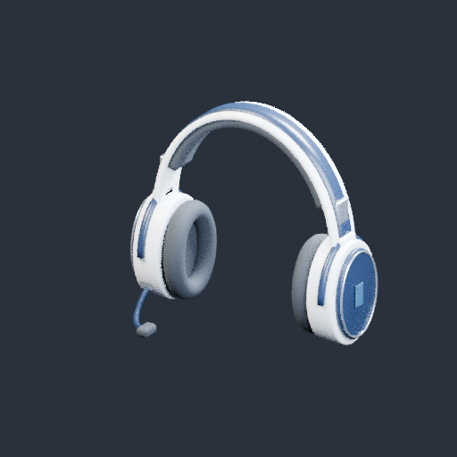
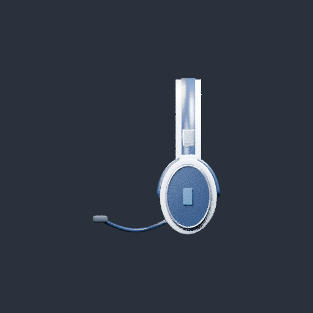

# RefAs 2.0 native production evidence

This record was captured from the actual public `produce.py` interface using
**Blender 4.3.2**, Cycles CPU, 512 × 512 pixels, 16 samples, and denoising off.
The source-file hashes in [`demo-evidence.json`](demo-evidence.json) identify
the exact implementation and fixture scripts that ran. The harness checks
those source hashes again before writing a successful record.

The subject is an original scripted headset. **There is no reference image.**
This record demonstrates editable production, local-change preservation,
failure isolation and exact recovery. It is not a reference-likeness benchmark,
a comparison of models, or a game-ready asset certification.

## Reproduce

From the repository root:

```bash
PYTHONDONTWRITEBYTECODE=1 python3 examples/production-workflow/run.py \
  --root examples/production-workflow/output/native-evidence \
  --size 512 --samples 16
```

Choose another new `--root` if that directory exists. The harness refuses to
overwrite an existing directory. `--blender` can select an executable. The
default root, when omitted, is `examples/production-workflow/output/demo`.

The harness invokes `doctor`, `init`, creation, local revision, an intentionally
failing edit, `status`, `restore`, and `verify` as eight public CLI subprocesses.
It writes command logs, the complete native/GLB revision bundles and a JSON
evidence record inside that output directory. It does not call private runtime
functions or replace Blender with a test double.

## Recorded checks

| Check | Observed result |
| --- | --- |
| Creation | 30 separately editable mesh objects; 9,856 native vertices; 19,608 triangles; UVs on all 30 objects |
| Native save/reopen | Recorded current-frame fingerprint matched after reopening the saved `.blend` |
| GLB export/import | Actual import into a fresh scene; 30 mesh objects, 19,608 triangles and 5 encoded materials |
| GLB bounds | Matched the native bounds within the recorded tolerance, approximately 0.00002472 Blender units |
| Diagnostic isolation | Encoded GLB contained zero cameras and zero lights |
| Local revision | `HeadbandComfortPad` widened by 18%; only that object's recorded fingerprint changed |
| Other parts | All other 29 object fingerprints retained; no objects added or removed |
| Matched views | Hero and side camera specifications were identical before and after the edit |
| Captured input | The revision's `base.blend` hash exactly matched the previous native artifact |
| Failed edit | Script changed the in-memory headband, then raised; current revision and project publication-state bytes stayed unchanged |
| Failure evidence | Failed run remained separately recorded; no successful revision was published |
| Restore | Published a new revision whose entire artifact and captured-input inventories matched the first revision, including every file's size and SHA256 |
| Earlier history | Both original revisions still matched their recorded inventories after recovery |
| Final verify | Passed the declared `recorded-file-integrity` scope; likeness and game readiness remained unevaluated |

The imported GLB had 15,262 vertices, compared with 9,856 native vertices. Export
can split vertices at UV/normal boundaries; the verified triangle counts and
bounds still matched. This record does not require byte-identical independent
rebuilds. Its exact hashes identify these captured files, while the harness
reproduces the workflow assertions on a new run.

## Actual render observations

These four PNGs are **byte-for-byte copies of the worker's original outputs**.
They were not composited, cropped, resized, denoised or retouched after rendering.
[`observations.json`](observations.json) maps each published filename to its
original revision, artifact name, byte size and SHA256. The corresponding camera
specifications, renderer settings and source-scene fingerprints remain in the
full evidence record.

| Before local edit | After widening the comfort pad |
| --- | --- |
|  |  |
|  |  |

The change is deliberately local and visually modest. The fixture checks
preservation during a targeted edit; it does not claim a major aesthetic
improvement. Sampling noise is visible because these are diagnostic renders.

## Evidence files and scope

- [`demo-evidence.json`](demo-evidence.json): sanitized public-command results,
  source-file hashes, all assertions, native/GLB verification results, full
  before/after/restored artifact and input inventories, camera records and
  declared limitations. Workspace paths are repository relative; original
  artifact hashes and sizes are retained.
- [`observations.json`](observations.json): provenance and hashes of the four
  original PNG copies included here.
- The large `.blend` and GLB files remain in the generated output directory.
  They can be regenerated with the command above and are not duplicated in
  this committed evidence directory.

This is one small static fixture on one tested Blender version. It does not
exercise a full character, animated deformation, texture painting quality,
collision behavior or import into a game engine. The modeled adjustment rails
and microphone are editable geometry, with no mechanical or animation proof.
The native inventory has no armatures or shape keys, so this run makes no claim
about their preservation. Node-group internals, drivers and complete animation
or simulation states are outside the exhaustive fingerprint coverage. Separate
production tests cover additional worker boundary regressions; their results
are not substituted for this end-to-end record.
