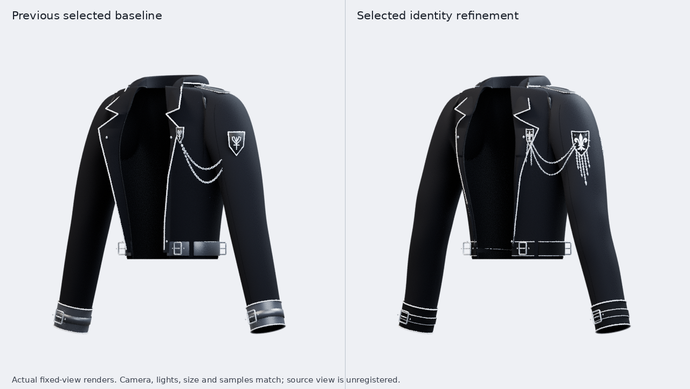
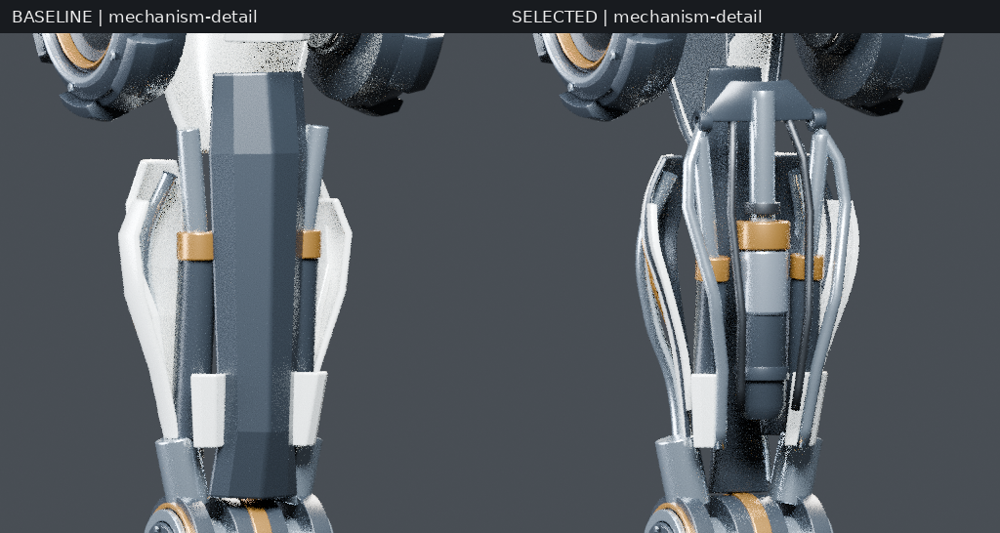
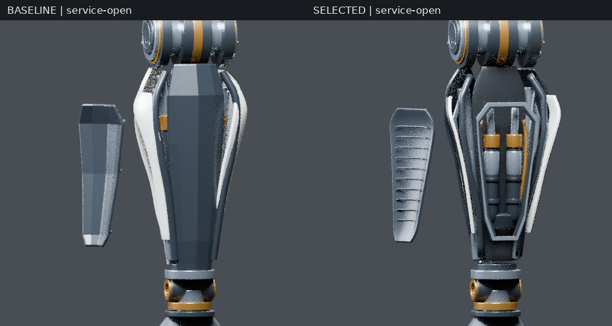

# Source identity: jacket cloth and articulated arm construction

This checkpoint continues the selected native assets delivered before the
`1280b74d` distribution/import checkpoint. It addresses source-visible geometry
and repeatable local editing using the unchanged extracted `2.0.0-alpha.1`
production package. The full protocol and claim boundaries are in
[PROTOCOL.md](PROTOCOL.md).

## Delivered files

| File | Contents | Size |
| --- | --- | ---: |
| [refas-source-identity-models.zip](https://chatgpt.com/library?file_id=libfile_76ab1fe190588191a17df58137f192fe&account_id=personal) | Selected native/GLB, original input/reference, executable reproduction scripts, deliberate local edits, actual comparison images and reports | 46,370,426 bytes |
| [refas-source-identity.tar.gz](https://chatgpt.com/library?file_id=libfile_995afebb2c88819193454269e1688289&account_id=personal) | Full main and diagnostic production projects, all retained candidates/failures, originals, selected/edited/restored assets, captured scripts, logs and anonymous review packet | 246,316,495 bytes |

The model archive verifies all 96 manifest entries. The full history verifies
all 1,761 entries, using internal hardlinks for repeated identical payloads.
`tar -xzf refas-source-identity.tar.gz` reconstructs the full folder. Both main
projects passed public CLI verification after relocation to the delivery path.
The [delivery receipt](delivery.json), [model checks](models-verification.json)
and [complete-history checks](archive-verification.json) bind these files to
exact SHA-256 identities. The initial larger ZIP failed during upload preparation;
no finalization occurred, and the smaller lossless archive saved successfully.

## Result and acceptance

**K4 is demonstrated for the declared prototype scope. The fixed plan advances
from 27/31 (87%) to 28/31 (90% rounded).** The independently reviewed selected
assets are jacket `identity-04` (`d83189287d4d458397b05534083f00e1`) and arm
`candidate-05` (`e661b5fd53e447879bd4baff5f4bbb9f`).

An isolated session inspected both complete original sheets, all 44 individual
candidate renders and all five anonymous comparison boards. It preferred
jacket A and arm B, the two new selected candidates, and found each meets the
source-specific identity and major construction of its declared prototype.
The reviewer separately rejected both as finished art. Read the complete
[unmodified review](review/isolated-visual-review.md),
[label mapping](review/anonymous-mapping.json),
[neutral requirements](review/requirements.md) and
[recorded acceptance decision](assessment.json).

This decision is supported by specific repaired construction: coherent jacket
crest/chain/pendant attachment and collar roll; exposed arm actuator structure
and a genuinely recessed service compartment. It is not credit for relative
preference alone. Remaining jacket piping/cloth regularity and arm palm/edge
finish are named in the review. No criterion was rewritten, split or removed.
E2, D2 and D3 remain open. R2-05 is ready for review, not CLOSED.

## What changed

| Asset | Source-led construction changes | Preservation and actual exercise |
| --- | --- | --- |
| Jacket | Chest-seated notched lapels and collar roll; restrained body/sleeve shaping; black straps distinct from silver buckles; filled fleur-de-lys shields, connected oval-link chains and hanging lance pendants | Original body cage topology and two shared 40-edge armhole seams retained. The 1 cm cuff exercise changes seven intended objects; 92 non-cuff objects, the distal cuff piping and material data remain unchanged. All 18 selected artifact/input files restore exactly. |
| AURIX arm | Nested shoulder/forearm shells and recessed carriers; exposed rear piston and side mechanisms; framed service bay with paired cartridges and an internally ribbed cover; differentiated palm and finger shells | All 300 original objects retained; 20 pivot origins and original parents preserved. Ten original material datablock snapshots are unchanged; 13 intended shell material assignments and two relocated crown markings are explicit. The 3 mm cover subtree changes 26 nodes and preserves 315 other objects. All 19 selected artifact/input files restore exactly. |

The before/after camera, lighting and renderer metadata match for each asset.
Added diagnostic views are rendered for both inputs. Jacket renders use
640 × 640 pixels and 32 samples; arm renders use 512 × 512 and 16 samples.
These are within-asset comparisons, not a matched speed comparison between
the two different tasks. The original sheets remain unregistered to these
diagnostic cameras.

### Native, GLB and pose checks

| Check | Actual selected result |
| --- | --- |
| Jacket independent native/GLB | 100 meshes and 493,958 evaluated triangles; names/parents agree, maximum bounds error 1.86e-9 m. Body/collar focused topology checks and shared armholes pass. Actual imported-GLB whole/ornament renders inspected. |
| Jacket final correction | Only the lower front draped chain changes geometrically from identity-03; the other 99 meshes are canonically unchanged. The failed chain clearance candidate is retained. |
| Arm independent native/GLB | 341 objects, including 321 meshes and 20 pivots; 271,840 triangles. No missing/extra objects or parent mismatches; maximum bounds error 4.25e-9 m. Actual imported-GLB views inspected. |
| Arm sampled articulation | Elbow 0°/45°/90° and combined elbow/wrist/index pose; all 41 added meshes follow their declared parents and independently predicted centroid motion. Separate exported-pivot checks pass. |
| Limited surface intersections | No intersections among 72 named upper/forearm shell pairs at each sampled pose, or 132 neutral cover/rib–cartridge pairs. These scoped observations do not prove complete or continuous collision clearance. |
| Arm focused topology | No introduced boundary, nonmanifold or zero-area faces in inspected new/reworked solid meshes. The two inherited crown-lettering outlines remain open. |

Raw checks are in [garment/](garment/) and [automail/](automail/). The code review
retains the initial defects, repairs and actual execution boundaries in
[initial review](code-review-initial.md), [repaired snapshot](code-review-final.md)
and [final addendum](code-review-addendum.md). Repairs include duplicate-label
and changed-input guards, explicit candidate selection on resumed exercise,
all-original native identity checks, truthful timestamp fields and packaging
guards that bind inspection hashes to the selected files.

### Remaining asset limits

These are static editable prototypes. The jacket still needs more natural
cloth and piping refinement; the arm needs smoother palm and armor-edge
transitions. No new rig, skinning, cloth/chain physics, production UV atlas,
texture baking, LOD or engine integration is claimed. Reauthored untextured arm
primitives replace their generic primitive UVs, reducing UV-bearing objects
from 136 to 69; this construction step does not preserve every old UV layout.
The separate local cover edit does preserve its selected geometry/UV/material
state. Neutral-cover opening is an exploded inspection pose, not proof of a
working hinge or physical mechanism.

## Provenance and reproducibility

The previous native bundle was recovered without alteration. Its archive CRC,
SHA-256 and all **547** manifest entries pass; see
[baseline-recovery.json](baseline-recovery.json). The two original source PNGs
retain their repository hashes. All **17** extracted package files match the
tested repository baseline; see [installed-package.json](installed-package.json).

Geometry scripts remain in the asset examples. The active skill, production
runtime, plugin metadata and npm payload are unchanged by this checkpoint.
The active skill remains 15 files including two cache exclusions, and the
package remains 17 files. Legacy files remain under `legacy/v1/`.

Literal author assignments and corrective prompts are recorded in
[prompts/](prompts/), with capture time and hashes in
[dispatch.json](prompts/dispatch.json). Rejected candidates and command failures
are retained. These are informed continuations using prior assets and criticism,
not independent no-skill / fixed-1.x / 2.0 experiment arms.

## Verification already completed

The required existing runtime/distribution gates completed successfully while
asset authoring continued. The runtime and distribution bytes did not change
during those runs. Exact command clocks, exits and scope are recorded in
[verification.json](checks/verification.json).

| Gate | This checkpoint's actual result |
| --- | --- |
| `npm test` | 935 passed, 0 failed, 0 skipped |
| `npm run test:python` | Passed the existing declared syntax check |
| `npm run check` | Repository, plugin, production distribution and legacy checks passed |
| `npm run dogfood` | All 11 retained checkpoints passed |
| `npm run release:audit` | Passed; 17 actual package files |

The previous checkpoint's 65 production test executions remain historical
evidence. They are not relabeled as a fresh execution here. New asset scripts
receive their own actual Blender authoring, edit, restore and readback checks.

## Measurement limits

Both authors record their CLI subprocess starts, ends, exit status and monotonic
duration, including failed attempts. The garment runner also identifies the
earliest image file timestamp separately from observing a complete render
bundle; nested Blender timings are only as detailed as the production command
actually exposes. A dispatch capture is not an exact author start. Neither
author had a complete pre-reading wall clock.

Two authors used Blender concurrently with two threads each. Repository gates
overlapped part of this interval. Their process durations and elapsed clocks are
observations under shared load, not matched performance comparisons. First
rendered candidate and first visually useful result are different events.

Provider/model snapshot, model tokens, billed model cost and infrastructure
price are not exposed. They remain null with an explicit reason; no estimate is
inferred from tool counts, file sizes, CPU time or subscription price. This work
does not satisfy E2 by itself. Main merge and formal publication remain separate
open milestones.
