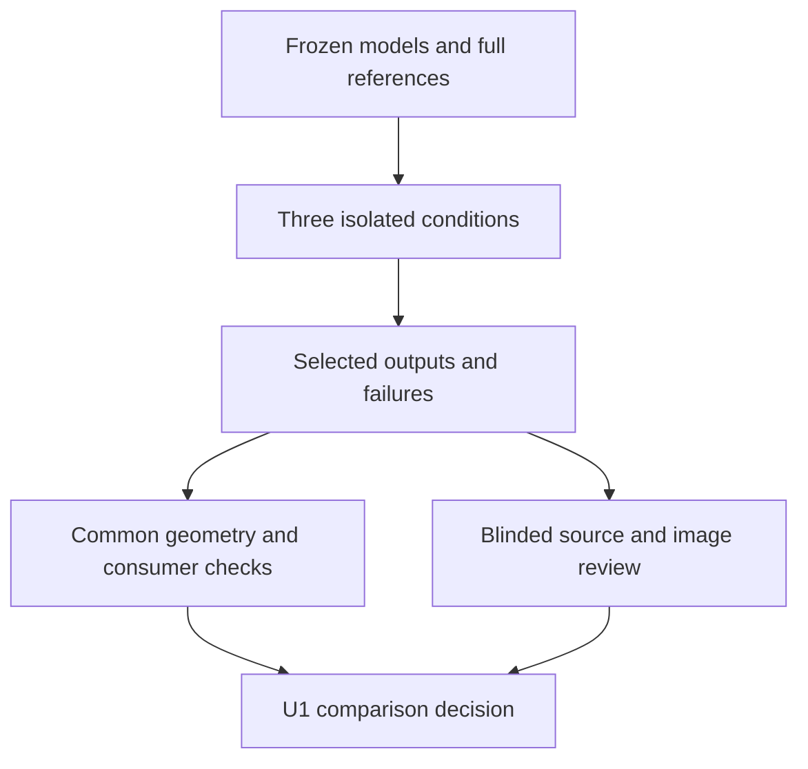

# Matched continuation comparison

## Acceptance boundary

The 2026-11-26 prospective experiment demonstrates **U1 only**: both real task
types were compared under the same declared inputs/resources for source likeness,
mesh/attachment condition, useful motion, functional retopology and delivery
optimization. Failed and missing results are retained. **E2 remains open**;
this is one run per condition, without provider/model snapshot, tokens or billed
cost. The experiment does not accept any garment for use and does not claim
reconstruction or animation creation from scratch.

The common inputs were garment `c67633a23446fceb4391a95f568a593e630a33969901069f31dd60cdf8af600e`
and arm `badf3fd5134ea44c77bef19890cf0f3157c8e2dbe622484eba7df713791d36f1`,
plus both complete original reference images. Task SHA-256 is
`1174c31e9b609725fd1157bc5d564a6c909ced4fa049993552f505b32c46a691`.
Product snapshots were none, fixed 1.x `a29bcc42f4da666c812462eb130836f2d766b0a1`,
and 2.0 `f174f6b1cf9ce19ce905b58490d117aca01cea4b`. Authors used isolated
condition directories without cross-condition result access or model overrides.

Each condition could run at most 24 Blender processes and 1,800 active Blender
seconds across both assets. The declared environment was Blender 4.3.2 with two CPU threads, Cycles 512px/16 samples and Godot 4.7.2.
The independent observer was outside the author budget. Interrupted plain
telemetry is retained with a conservative upper bound, not invented exact timing.
All recorded or conservatively bounded author work remained within the caps.

## Results

| Common observation | No skill | Fixed 1.x | 2.0 |
|---|---:|---:|---:|
| Garment triangles / primitives |120,658 /111|121,298 /111|121,778 /111|
| Arm triangles / primitives |86,514 /99|86,514 /99|85,084 /99|
| Garment finite sampled error,mm |0.435586|0.444309|0.290884|
| Arm finite sampled error,mm |0.173278|0.173088|0.105745|
| Blinded visual result, both tasks |Tie|Tie|Tie|
| Actual garment Godot, default 20µm vertices |FAIL|FAIL|FAIL|
| Predeclared 100µm vertices, unchanged matrix threshold |FAIL|FAIL|FAIL|
| Actual arm Godot, 121 frames |PASS|PASS|PASS|

All candidates meet their unchanged polygon/material and finite-error budgets;
both starting assets already met the polygon budgets. Each author performed
inspectable local topology reconstruction. Common distance measurements use
every vertex and triangle centroid in both directions at garment 1/49/97 and
arm 1/61/121: finite samples, not exact Hausdorff or source-image similarity.
An independent blinded reviewer inspected both full references and all 54 result
images; no visible quality ranking is supported.

Every garment retains 10,765 opacity-confirmed hair/cloth contact pairs at each
of the three common sampled poses. Unclassified overall contact counts include
intentional seams/hardware and are not defect counts. The 2.0 cuff support was
unresolved. Native garment incidence checks pass, but export index splits and
the 2.0 arm's coincident-position diagnostic remain explicitly classified or
unresolved rather than silently accepted.
The 2.0 arm’s author export-geometry verdict remains **FAIL**, with 35 nonmanifold
and 60 inconsistent-winding edges in the exact-coincident-position diagnostic.

The corrected Godot garment observations still fail at the unchanged 2e-5
maximum matrix-element threshold. The 2.0 remaining 388 failures at 100µm are four
original unused hair bones × 97; a zero-positive-weight diagnosis is recorded,
but no all-bone exemption is applied. Later informed garment repairs are separate
evidence. Fixed 1.x's edit/restore uses the supplied baseline before retopology;
selected-candidate replay is NOT_EVALUATED. Plain and 2.0 selected-candidate
exercises are retained within their stated scope.

## Observer corrections and preservation

Uniform amendments handle actual clip start times, explicitly retained hidden
construction copies, unskinned points, original-name import mapping and live
BoneAttachment updates. Previous failures remain. A known-motion fixture passes
and detects a 1mm error; cached/uncached resolved plain observations agree exactly
for all 97 samples. No model, threshold or original all-bone verdict was changed
to improve a condition's result. No speed, cost, GPU frame-time or general
product-superiority claim follows from this experiment.

Independent acceptance re-hashed all 12 selected native/GLB files, six retained
detailed inputs, common frozen files and both product manifests; all matched.
The coherent private evidence archive contains 939 entries, including raw results,
scripts, models, local edits, rejected candidates and 54 review views. Its exact
SHA-256 is `9d04a51d568af4a2e2f2bfc4ff6fbd56dee6f0e88a6195866b4a838d24e95365`.
All regular payload hashes and internal links were verified after compression.
Reproducible import caches and Git-backed product source copies are omitted;
their fixed commits/hash manifests remain.

- [Standalone comparison report](https://chatgpt.com/library?file_id=libfile_44fd600c1ca08191a9ea1e7e53c07244&account_id=personal)
- [Archive manifest](https://chatgpt.com/library?file_id=libfile_aeeea22238308191a061f1faaf03b7f9&account_id=personal)
- Archive parts in order: [1](https://chatgpt.com/library?file_id=libfile_448107fec74081919f3e6da19e326c2f&account_id=personal), [2](https://chatgpt.com/library?file_id=libfile_91a336f59df48191befeb64618b533a3&account_id=personal), [3](https://chatgpt.com/library?file_id=libfile_8df303e204d08191954b718f123aa8ab&account_id=personal).

Private links require the owner's access; no user model, image or raw numerical
payload is added to Git. Restoring or replacing this evidence must preserve the
frozen task, product versions, original unfavorable verdicts and independent
review. No denominator, prior checkpoint, U2/U3/U6 decision or release boundary
is changed by the comparison itself.
