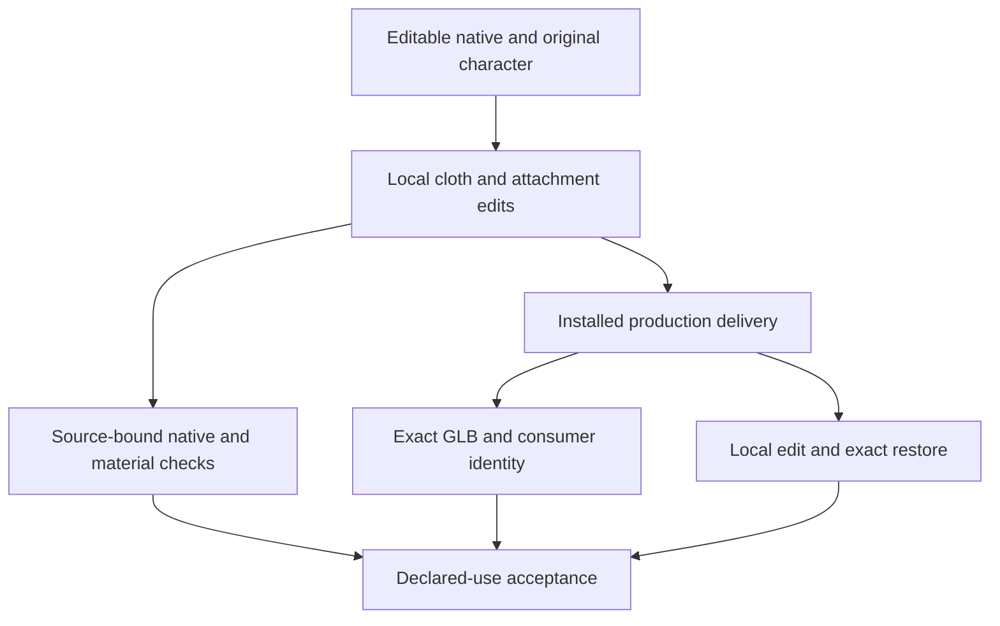

# Usable garment delivery

## Accepted scope

The retained reference-derived jacket now has one frozen native/GLB pair for
the identified original character and the declared 97-frame motion. Independent
native, source-domain, export, actual-consumer, material-view and installed
edit/restore evidence supports **U2 and U3**, and the garment contribution to
**U6**. Reusing the unchanged, previously accepted arm completes the two-asset
U2/U6 scope. This checkpoint adds U2/U3/U6: **33/37 = 89% rounded**. The separate
prospective comparison owns U1; E2, D2 and D3 remain open.

The selected garment revision is `02999322194f411dad43dfc1cd297739`:

| File | SHA-256 | Bytes |
|---|---|---:|
| Native | `624a1a90ec3dfb38f65ddd2631a4d25c7a7525dbb3464891a2c7375f151720d7` | 206,098,012 |
| GLB | `af91555ab7654bc0107c5afefc2bed3c3772b93ac62a971030cfd4e467cd70ff` | 105,268,504 |

The author native is `a063800dfbde88d5e4db1a16d77fa7c8ee36e9e8b16ea36a0a52d4765048f3d3`.
Installed production relocated 30 SHA-verified derivation receipt paths. Independent
comparison preserves all 255 object states, raw mesh/key/attribute/weight/UV/
material/rig/action data and all 126 world-coordinate digests at all 97 frames.
Original character geometry, materials, visibility and rig remain intact.

## What changed and why

Local lower and upper cloth fitting repairs the original character contacts;
two bounded seam corrections repair the remaining main sewing-domain and
right-shoulder perimeter violations.
Nine existing chain links receive fixed source-local rotations. Four studs,
four waist frame/tongue pairs and two cuff frame/tongue pairs receive coherent
rigid mount transforms. In particular, waist frames now follow the actual
curved belt footprint instead of retaining a front-facing plane. All original
rest bones, raw hardware geometry and 389 adjacent chain connections remain.

The final mount change touches 16 original bones through 112 location/quaternion
curves. All 110 other evaluated meshes and 430 other hardware poses remain
exactly equal throughout the clip. Source construction parameters and finite
contact domains are unchanged. Four studs use their original own-belt contact
rows; the old optional left-front frame contact row is unused. Curved-frame
clearance varies, including a roughly 2.17 mm left-front sampled span and a small
left-rear lip overhang. The 150/50 micrometre source settings describe rest
construction targets, with no physical pin/threading or uniform-motion claim.

The necessary repository observer repair is at
[`d02f6188`](https://github.com/ictseoyoungmin/refas/commit/d02f618801167040145087812abfaa3ff5e69dcc):
original GLTF names resolve through importer names to unique live mesh nodes;
unskinned points are measured; bone-attached children update after seeking.
Explicit paths handle ambiguous names. A finite positive timeout option keeps
the existing 120-second default. Raw skin arithmetic and precision thresholds
are unchanged. Installed production remains the exact
[`f174f6b1`](https://github.com/ictseoyoungmin/refas/commit/f174f6b1cf9ce19ce905b58490d117aca01cea4b)
package: 19 skill files and 23 package files. The
[maintenance map](../../refas-2-skill-map.md) identifies callers and removal
effects; these repository observation tools do not become mandatory authoring
steps or an installed geometry solver.

## Executed evidence

| Observation | Result and boundary |
|---|---|
| Native garment condition | 100 garment meshes, 97 frames; intended source interfaces classified, no new incidence/winding/degenerate defects in the declared authored scope. |
| Cloth and hardware contacts | Original finite source domains and unchanged 23/37 hardware policies; all 97 forbidden hardware/cloth/avatar counts zero, all 446 closed rigid components positive and 389 adjacent links retained. Changed interfaces are recomputed; unchanged scopes transfer through exact input/coordinate/pose equality. |
| Actual GLB correspondence | All 100 meshes, every oriented/material triangle, all 97 frames; maximum mapped error 1.134447 micrometres within the unchanged 2 micrometre limit. |
| Raw export data | Base normals/UV corners, 49 authored garment morph phases, all 97 motion times and original positive skin influences retained. |
| Original character | Supplemental exact-source cycles/index/material and positive-weight checks pass; raw 26-mesh replay passes all 97 frames, maximum 1.463364 micrometres. Strict/reimport failures below remain. |
| Actual Godot 4.7.2 | 451 bone and 488 point probes at all 97 times; predeclared 100 micrometre profile passes. Maximum point error 43.562526 micrometres; maximum matrix-element error 8.34465e-7 against 2e-5. |
| Critical consumer interfaces | 72 pairs × 97 = 6,984 actual observations pass; all 72 copied-face, wrong-relation or moved-perimeter controls detect their stated defect. Four original stud contacts persist. Closest selected separated pair is 13.978585 micrometres; this is a selected-face scope. |
| Exact consumer identity | 48 nodes, 144 face instances, 458 selected corners/boundary points and 44,426 frame identities; original indices, selected morphs and raw imported weight identities verified. Static compression route is disclosed below. |
| Actual material review | Original full reference and actual whole front/back/rest/posed views plus six saved-native grazing details; major visible mount float repaired. Diagnostic noise, source-camera registration and finished-art fidelity remain separate. |
| Installed local edit/restore | Left cuff distal length +10 mm, all 253 unrelated objects protected, complete rim and distal piping relationship retained at frame 1. All 8 artifact and 2 captured input files restore exactly; current restored revision `64cf60f1006d417ba4ce4674e672e196`. |

The 451 consumer bone probes are the original five declared avatar bones plus
446 hardware bones. This wearing profile does not clear the known matrix
failures of four unused source hair bones in the independent U1 experiment.

The transient cuff edit exercises native authoring and recovery. Its frame-1
attachment observation and 49-key data coherence do not add a newly approved
motion/export clip. Existing accepted arm evidence is reused after all 92
manifest entries are freshly re-hashed; no new arm run is claimed.

## Fixed optimization budgets

| Measure | Jacket | Unchanged arm |
|---|---:|---:|
| Delivery triangles / fixed maximum | 122,898 / 125,000 | 86,564 / 110,000 |
| Material primitives / fixed maximum | 111 / 150 | 99 / 180 |
| Finite sampled surface error / limit | BODY 1.400601 mm; COLLAR 1.477631 mm / 1.5 mm | 0.423727 mm / 0.6 mm |
| Declared motion | 97 frames, 30 fps | 121 frames, 30 fps |

The full garment/character scene has 812,985 triangles and 178 primitives;
the unchanged character contributes 690,087 triangles. Garment raw skin has
at most three positive influences against its fixed four-influence cap.
Editable detailed BODY/COLLAR and the arm's detailed functional source and
mappings are retained. Surface errors are stated finite samples against the
repaired detailed sources, with no continuous Hausdorff or GPU speed claim.

## Retained negative results and limits

- The default 20 micrometre Godot point profile remains **FAIL: 5,883 checks**.
  Its original results are retained alongside the passing, previously declared
  100 micrometre profile; matrix and rest-association limits are unchanged.
- Original-character strict geometric correspondence remains **FAIL** at rest,
  with 96 frames deliberately unassessed by that strict route. The original
  character includes 546 zero-area faces and one near-collinear boot case.
  Supplemental Blender reimport positions also exceed 2 micrometres for one
  original mesh at frames 28/70 (2.017388 micrometres). Raw replay and actual
  consumer observations have separately named evidence and verdicts.
- Direct raw/live static-hair position equality remains **FAIL**. The exact
  installed Godot source and observed format/AABB establish uint16 static
  position compression. Raw GLB and ImporterMesh source arrays match exactly;
  explicit forward encoding reproduces all 124,765 live positions bit-exactly.
  The independent replay uses zero tolerance and no fitted parameters. A
  copied one-ULP live-position corruption is rejected by that exact predicate.
- Earlier exact triangle-pair and refitted-rest bind failures remain. Accepted
  classifications use the unchanged original oriented/material/sheet/source
  lineage and finite construction domains. Rejected pre-seat mounts, one-sided
  fits and other failed intermediate models stay recoverable.
- The unchanged arm retains 796 intentional planar branding-outline boundary
  edges and the explicitly documented unused generated UV omission on
  `Crown_A_mark`; its original source remains available.
- This covers one identified character, the declared poses, ordinary skinning
  and baked rigid motion. Continuous collision freedom, arbitrary sizing or
  poses, cloth/fastener physics, full-scene engine collision freedom, finished
  art, GPU performance and formal release are outside this acceptance.

## Evidence and recovery

- [Selected usable assets and editable sources](https://chatgpt.com/library?file_id=libfile_5917b00efee88191812cacc7177e0ed0&account_id=personal)
- [Exact acceptance and evidence identities](https://chatgpt.com/library?file_id=libfile_d73a794ecf7c819187cdd739a86fbfd7&account_id=personal)
- [Coherent recovery manifest](https://chatgpt.com/library?file_id=libfile_381cacb9ea34819187a8aff364d5047d&account_id=personal)
- [Recovery assembly index](https://chatgpt.com/library?file_id=libfile_157f654f31dc81919af24ef6e62e3d04&account_id=personal); [part 1](https://chatgpt.com/library?file_id=libfile_4a970c65a8b08191a1d216bdf24ce15a&account_id=personal), [part 2](https://chatgpt.com/library?file_id=libfile_ddd24e32d9a88191b31fd512d052cced&account_id=personal), [part 3](https://chatgpt.com/library?file_id=libfile_9c6b8ab01da08191b1edaf2d5aaccf6c&account_id=personal), [part 4](https://chatgpt.com/library?file_id=libfile_e241ee9399108191b378f27b6c5fb8bb&account_id=personal), [part 5](https://chatgpt.com/library?file_id=libfile_109ec66a7b588191b20b1074634353f7&account_id=personal)

The recovery contains the working project, unique source/rejected natives,
private task scripts, raw reports, source domains, bindings and actual images.
Four explicitly inventoried large coordinate caches are reproducible rather
than raw archived; their original manifests, source natives and capture recipe
remain. Canonical product source is recovered from the pinned Git commits.
The independent U1 comparison has its own frozen outputs and judgments.

Source changes passed 948 JavaScript tests, all five required repository gates,
187 actual Blender/Godot Production tests with zero skips, including 17 engine
tests, and exact-head remote CI. The final documentation head has its own
repository checks. Main integration and formal publication remain separate;
no runtime assessment or release is automatically promoted by this report.
