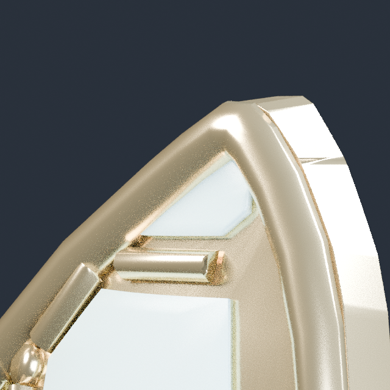
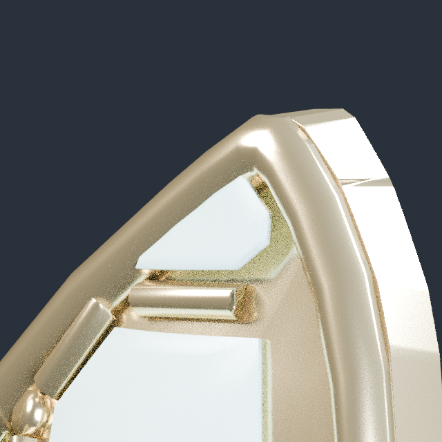

# Fresh-session use of the installed skill

The [literal task](../prompts/forward-use.txt) was saved before dispatch to a
fresh agent thread. It received only the installed skill path, actual old
project, selected checkpoint/artifact and requested local edit/recovery task.
It received no repository implementation, tests, earlier diagnosis or expected
verification results. The task explicitly identifies the generated source
fixture and its limited scope.

The agent imported the old asset, read the production review guide, chose fixed
hero/detail/grazing views, raised `panel:cell-00` outward by 0.025 scene units
along Blender negative Y, inspected actual renders and restored the imported
starting revision. The raised option remains a separate revision. This is
ordinary local asset use, not a fair cross-condition authoring benchmark.

The [original report](REPORT.md) and [literal commands](commands.md) retain
their workspace paths and original sandbox links. Portable copies of the
relevant images, scripts, review settings and logs are in this directory.
The full native projects were inspected during execution; native/export hashes
are recorded in the logs, without duplicating those entire projects here.

| Evidence | Result |
| --- | --- |
| [Preservation check](logs/preservation-check.json) | One target transform changed; all 65 other object records and target mesh/material state preserved; GLB binary geometry unchanged |
| [Restoration check](logs/restoration-check.json) | Six artifact and five input files restored exactly; all 247 old project paths/hashes unchanged |
| [Raised integrity](logs/verify-raised.json) and [restored integrity](logs/verify-restored.json) | PASS |
| [Final state](logs/final-status.json) | Imported, fixed-view baseline, raised option and restored head all retained; current sequence 4 |
| Installed skill identity | All 13 files still match the npm package parity record after this session |

The root reviewer independently inspected the following two actual images. The
raised edge is visible; surrounding geometry is preserved. No independent art
approval, engineering attachment assessment or game-engine readiness is inferred.

| Fixed grazing view before | Fixed grazing view after |
| --- | --- |
|  |  |

The session's first restoration helper used the wrong reference directory.
Its [initial failure](logs/restoration-check-first-attempt.log) remains intact;
the helper was corrected using the observed source location and the full check
then passed. Production operations themselves succeeded. The reference remains
a generated contract fixture; no actual-photo reconstruction claim is made.
