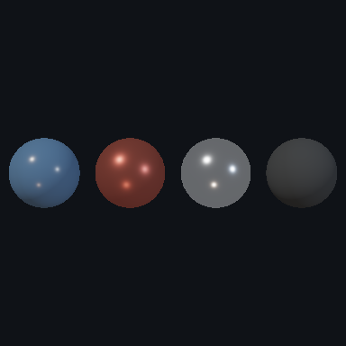
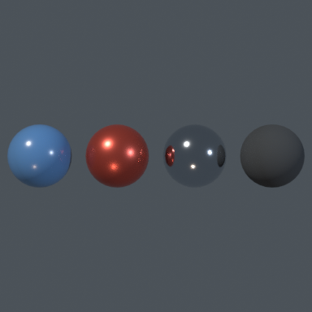
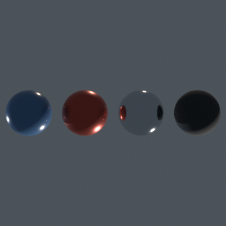

# Actual E3 renderer-isolation run

The same GLB, perspective camera, triangle coordinates and known material factors
were verified across the retained CPU PBR and external Blender paths. All 11
declared checks passed. This establishes a comparison of the two recorded
rendering configurations; it does not establish visual equivalence, a quality
winner, source-reference likeness or 2.0 model superiority.

## Evidence

- Input: `known-materials.glb`, 27,120 bytes, 4 mesh objects, 3,840 triangles.
- SHA-256: `005f4e2f463c88d0cc10a46e9ca16fa5f98a8bac098e6cb8726cdd00694da3af`.
- Python 3.12.14, NumPy 2.3.5, Blender 4.3.2, Cycles CPU, 32 samples, 384 × 384.
- Camera: `(0, 0.55, 8)` toward `(0, 0.55, 0)`, `+Y` up, vertical FOV 31°.
- `commands.json` records the actual driver invocation, CPU calls and Blender
  invocation; `blender-config.json` records both beauty configurations.
- `blender-observed.json` records actual imported geometry, corner normals,
  material slots, projected coordinates and camera/light/output settings.
- `result.json` contains the check results, source-code hashes, PNG hashes,
  material samples and full profile declarations.
- `blender.stdout` and `blender.stderr` retain the process logs.

| Check measurement | Observed | Declared tolerance |
| --- | ---: | ---: |
| Maximum world-position error | 8.3447e-8 | < 1e-6 |
| Maximum projection error | 1.7128e-7 NDC | < 1e-6 NDC |
| Maximum smooth-normal component difference | 1.5321e-4 | Recorded diagnostic |
| Maximum smooth-normal angle | 0.008950° | < 0.1° |
| Coverage IoU | 0.9911606 | Recorded diagnostic |
| Unmatched coverage outside two-pixel band | 0 pixels | 0 pixels |

The input GLB and all three legacy renderer files remained unchanged. The two
harness source files also remained unchanged during execution. No production
runtime or skill file was used as a destination for the experiment.

## Visual observations

The assistant inspected all five PNGs after the run. The four materials retain
the same order, placement and silhouette. The albedo interior sample differences
are small (at most 3/255 per channel in the recorded 7 × 7 median patches), with
the expected edge sampling and transfer-function differences.

The matched-direction beauty images place the principal front highlights in the
same general region. The same-sign SUN control moves strong highlights toward
the rims and darkens the viewed hemisphere of the polymer, paint and rubber.
Only light propagation signs changed between the two Cycles beauty inputs.

Cycles visibly has a world background and reflections of adjacent spheres on
the bare metal; the CPU image has the fixed dark background and its analytic
ambient response. The low-sample Cycles beauty has visible highlight noise.
Neither appearance has been approved by the user. The machine-readable result
continues to state `visualAcceptance: requires-human-inspection` and
`certificationEligible: false`.

### CPU beauty

### Cycles beauty with matched propagation direction

### Cycles same-sign direction control

### Albedo controls

## Retained initial rejection and normal investigation

The previous `run-01/result.json` remains `ok: false`; the provisional
componentwise normal threshold was `2e-5`. All other checks passed. Its original
harness is frozen under `run-01/harness/`, and its `validation-note.json` records
why that result was retained.

The separate `normal-roundtrip/` experiment passed the fixture's normals through
Blender's `Mesh.from_pydata` and `normals_split_custom_set_from_vertices`, without
using either the glTF importer or a renderer. Its maximum component error was
`0.000153183937` and maximum angular error was `0.008948763°`, reproducing the
import observation. The final harness therefore separates strict position
identity from a declared 0.1° normal-direction tolerance. It reports both
component and angular differences and does not claim bitwise normal identity.
This finding describes Blender 4.3.2 in this run, not a universal tolerance
guarantee.

## What the result resolves

This experiment removes changed geometry, material factors and camera placement
as explanations for the observed beauty differences, within the recorded
numeric tolerances. It also demonstrates why blindly passing CPU `L` as a SUN
propagation vector is an invalid light-direction match. The evaluation config
uses `-L`; the legacy algorithms remain unchanged.

The remaining differences include analytic ambient versus world illumination,
Cook–Torrance approximation versus Principled BSDF, scene reflections, finite
SUN angular size, antialiasing, sampling, background, and Reinhard/gamma 2.2
versus Standard/sRGB output. Equal source material factors and numeric light
energies are not full shader or radiometric equivalence.

This small opaque factor-only fixture does not establish texture, transparency,
deformation, general renderer correctness, art-quality, authoring-cost or broad
performance claims. It also does not register a camera to either user reference
image or change the 2.0 production camera contract.

Observed elapsed times were 0.494200 s for one CPU albedo call, 1.410024 s for one
CPU beauty call and 6.553502 s for the Blender process. The last measurement
includes startup, import, three renders and scene observation, so these figures
are execution records rather than a performance comparison.
