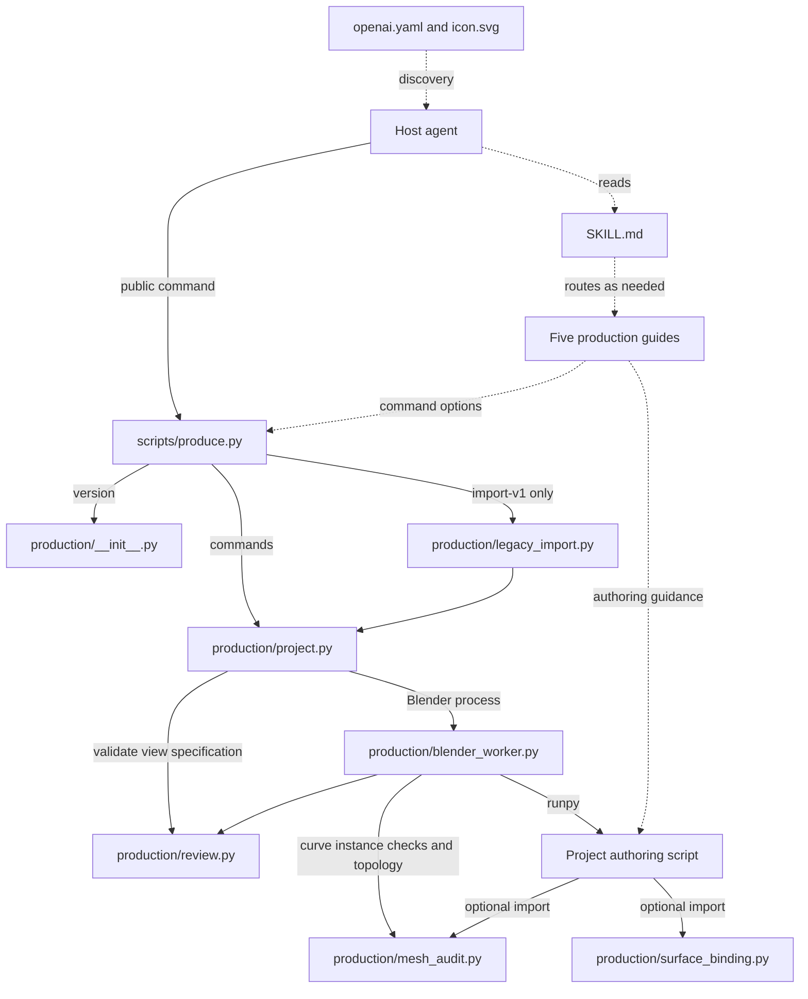

# RefAs 2.0 skill relationships

This map explains what the installed skill contains, who uses each element,
and what a change or removal affects. It is a repository maintenance document;
agents making assets start with the installed `SKILL.md`, not this map.

The [distribution allowlist](../../tools/verify-production-distribution.mjs)
declares **16 installed skill files**: eight Python files, five guides, the
skill entry, discovery metadata and one icon. Two `.npmignore` files also live
in the source folder but are excluded from the package. The complete npm
package has 20 files: those 16 plus the root README, LICENSE, package metadata
and [Node launcher](../../bin/refas.mjs). The launcher delegates to Python;
the copied Python skill can run without Node.

## Relationship map

Solid arrows mean an import, command or process invocation. Dotted arrows mean
discovery or guidance read by the host agent. `production/` abbreviates
`scripts/production/`. The project-specific authoring script is outside the
installed skill.

The guides influence the agent's commands and scripts; Python does not execute
Markdown. The worker adds its module directory to the import path before
running the author's ordinary `bpy` script. This makes documented helper
imports available without requiring repository-only code.

## Runtime files

Paths in the first column are relative to `skills/refas/`.

| File | Purpose and actual consumers | Change or removal impact |
|---|---|---|
| [scripts/produce.py](../../skills/refas/scripts/produce.py) | Public arguments, JSON output and command dispatch. Used directly by the agent or through the npm launcher. | Keep CLI help, SKILL examples, the launcher and copied-installation checks consistent. Removing a route also requires addressing its documented workflow. |
| [scripts/production/__init__.py](../../skills/refas/scripts/production/__init__.py) | Supplies `VERSION` to the CLI. Distribution checks compare it with package/plugin identity. | Coordinate version changes with `package.json` and plugin metadata. This small file is part of the import and identity contract. |
| [scripts/production/project.py](../../skills/refas/scripts/production/project.py) | Owns references, snapshots, revisions, integrity, recovery, temporary queries and storage cleanup. CLI and importer call it; it starts the Blender worker. | Changes can affect publication or recovery even when geometry code is untouched. Follow job/result contracts and source/revision integrity tests. |
| [scripts/production/blender_worker.py](../../skills/refas/scripts/production/blender_worker.py) | Performs Blender loading, authoring, save/reopen, object protection, observation, rendering and explicit export. | Follow its job/result contract with `project.py`, actual Blender tests, and source-bound observations. A host-only test cannot establish Blender behavior. |
| [scripts/production/review.py](../../skills/refas/scripts/production/review.py) | Validates fixed camera/light specifications in both the host project code and Blender worker. | Both callers and the review guide must agree. Preserve captured settings through save/restore and test actual views where relevant. |
| [scripts/production/mesh_audit.py](../../skills/refas/scripts/production/mesh_audit.py) | Observes evaluated topology and anchor gaps. The worker imports its curve-tessellation discriminator at startup and calls `audit_mesh` for topology queries. Authoring scripts can also import it. | It is not optional as a whole: deleting it also breaks normal worker startup and curve instance checks. Follow worker imports, query output, topology guidance and author scripts. |
| [scripts/production/surface_binding.py](../../skills/refas/scripts/production/surface_binding.py) | Optional numeric authoring API for binding and transporting a section on an explicitly chosen host triangle. No core module automatically calls it. | Search documented and retained author-script imports, not only core imports. Removing it retires the supported surface-attachment recipe and its tests. |
| [scripts/production/legacy_import.py](../../skills/refas/scripts/production/legacy_import.py) | Lazily loaded by `import-v1`; captures selected archived asset bytes and uses the current `project.py` path. | Coordinate the command, import guide, provenance capture and import tests. Despite its name, this is current 2.0 code; it does not import the retained 1.x runtime. |

## Guidance and discovery

| File | Why it exists and what it connects | Change or removal impact |
|---|---|---|
| [SKILL.md](../../skills/refas/SKILL.md) | Agent entry: asset intent, useful authoring/review loops, public commands and five on-demand guides. | Update affected command examples and guide routes. Keep development status and CI procedures in repository docs. |
| [references/production-assemblies.md](../../skills/refas/references/production-assemblies.md) | Segmented forms, pivots, local curve edits and the optional surface-binding API; links to topology guidance. | Check SKILL routing, the garment guide's attachment reference and helper examples. |
| [references/production-garments.md](../../skills/refas/references/production-garments.md) | Shared cloth boundaries, sleeves, folded collars and wearing/deformation; refers to assemblies and topology. | Keep construction advice consistent with those guides and the intended character/motion scope. |
| [references/production-topology.md](../../skills/refas/references/production-topology.md) | Mesh observations, curve-to-mesh delivery, retopology and optimization; demonstrates `inspect` and `mesh_audit`. | Follow CLI/query changes, helper APIs and incoming links from SKILL, garments and assemblies. |
| [references/production-review.md](../../skills/refas/references/production-review.md) | Fixed orthographic cameras and lights supplied through `--review-spec`. | Match `review.py`, CLI options and actual render behavior. |
| [references/production-import.md](../../skills/refas/references/production-import.md) | Explicit 1.x checkpoint/artifact selection, preserved bytes and unavailable authoring data. | Match the `import-v1` command and current importer; do not imply inherited asset approval. |
| [agents/openai.yaml](../../skills/refas/agents/openai.yaml) | Host discovery, displayed name, default prompt, invocation policy and the icon references. | Changes affect discovery/UX rather than Python geometry. Check the referenced icon and plugin identity. |
| [assets/icon.svg](../../skills/refas/assets/icon.svg) | Shared visual identity referenced by `openai.yaml` and repository plugin metadata. | Update both references if moved or replaced; the plugin distribution check requires the canonical icon. |
| [.npmignore](../../skills/refas/.npmignore), [scripts/.npmignore](../../skills/refas/scripts/.npmignore) | Source-only exclusions for generated Python bytecode. | Keep the source-folder allowlist and actual tarball cache-exclusion checks aligned. They are not two extra installed skill files. |

## Changes in context

This table records the affected relationships and their purpose, not a running
ledger of test totals or asset approval.

| Feature or maintenance change | Related elements | Why the relationship is needed | What to revisit if replaced or removed |
|---|---|---|---|
| Editable native curves | Worker inventory/protection/rendering; worker → `mesh_audit`; SKILL, assemblies and topology guides | Keep curve controls editable while observing their evaluated surface. Blender's implicit curve surface must be distinguished from genuine instances. | Curve state preservation, evaluated bounds, instance rejection, explicit mesh delivery and guidance. No additional installed module was introduced. |
| Topology summaries and requested details | CLI → project → worker → `mesh_audit`; SKILL and topology guide | `inspect --topology` gives summary facts. `--topology-details` requests the bounded location/component records when needed and implies topology. This reduces routine response size without changing the underlying defect observations. | CLI defaults, explicit detail selection, Python API compatibility, worker response shape and source-integrity/cleanup guarantees. Existing Python callers retain their detailed default unless they explicitly request summary output. |
| CI and relationship reporting | Repository workflows, tests, distribution checks and this map | Normal CI uses Node 22/24; retained legacy JIT/deep suites have separate execution conditions. The map makes dependencies and removal impact inspectable. | Workflow triggers/conditions and their required gates. These changes do not add a Blender runtime dependency or an installed skill file. |

Both managed-project and standalone queries follow the same worker route.
Their temporary files, input hash checks and `persisted: false` result belong
to the project/query contract. Choosing more or fewer details is not permission
to save a new revision, convert the source or relax an observation.

## Existing checks to follow

Validation lives outside the installed skill. Use the checks that exercise
the changed relationship; a documentation edit does not require another asset
or render merely to update this map.

| Relationship | Existing verification |
|---|---|
| Installed file set and allowed internal links | [Distribution allowlist](../../tools/verify-production-distribution.mjs), [distribution tests](../../tests/production-distribution.test.mjs) |
| npm launcher and independent Python copy | [Packed-install check](../../tools/verify-packed-install.mjs), distribution tests above |
| Discovery, icons and plugin identity | [Plugin checker](../../tools/verify-plugin-distribution.mjs), [plugin tests](../../tests/plugin-distribution.test.mjs) |
| CLI/project, queries, integrity and recovery | [Project tests](../../tests/test_production_project.py), [resource tests](../../tests/test_production_resources.py), [native tests](../../tests/test_production_native.py) |
| Worker behavior and curves | [Blender tests](../../tests/test_production_blender.py), [curve tests](../../tests/test_production_curves.py) |
| Fixed review specification | Project capture/restore and validation tests; actual fixed-view Blender tests above |
| Animation and consumer execution | [Animation tests](../../tests/test_production_animation.py), [engine playback tests](../../tests/test_production_engine_playback.py) |
| Mesh observations | [Mesh-audit tests](../../tests/test_production_mesh_audit.py), native and curve query tests above |
| Optional surface-binding API | [Numeric tests](../../tests/test_production_surface_binding.py), [installed Blender tests](../../tests/test_production_surface_blender.py) |
| 1.x asset adoption | [Import tests](../../tests/test_production_import.py), Blender import tests above |
| Repository CI execution | [Normal CI](../../.github/workflows/ci.yml), [production CI](../../.github/workflows/production.yml), [Deep QA](../../.github/workflows/ci-deep.yml) |

The retained [`legacy/v1/`](../../legacy/v1/) code supports historical comparison
and regression checks. It is outside the production package and is not a
dependency of the current importer. Likewise, repository CI validates the
distribution but is not part of the installed modeling workflow.

## Keeping the map useful

When a feature changes an import, public command, authoring helper, guide route
or installed file, update the corresponding arrow and table row in the same
change. Reports should show the relevant relationship, the reason for the
change and its effect on callers, rather than repeat the entire file inventory.

Before removing an element, identify its callers, documented commands/recipes,
retained author-script imports, packaging entries and tests. An absent core
import does not establish that an optional authoring API is unused. Remove or
replace those references together only when the supported use is intentionally
retired. Keep user project history and prior assets separate from source cleanup.
