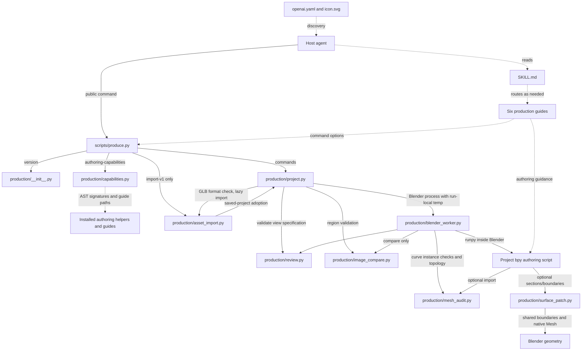
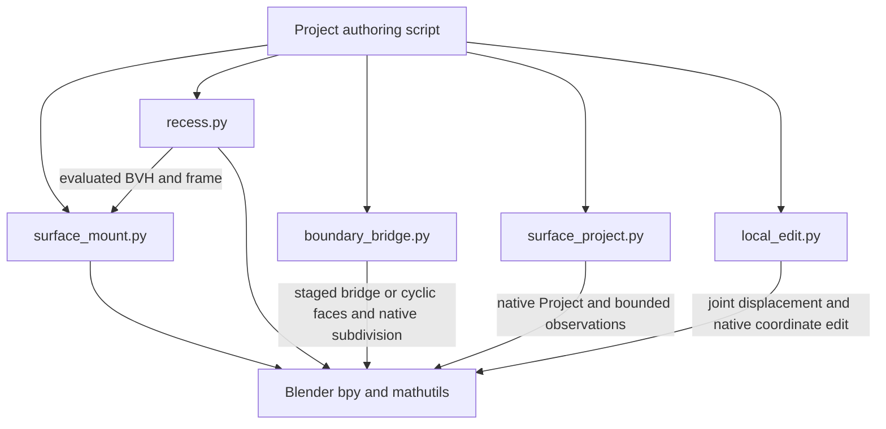
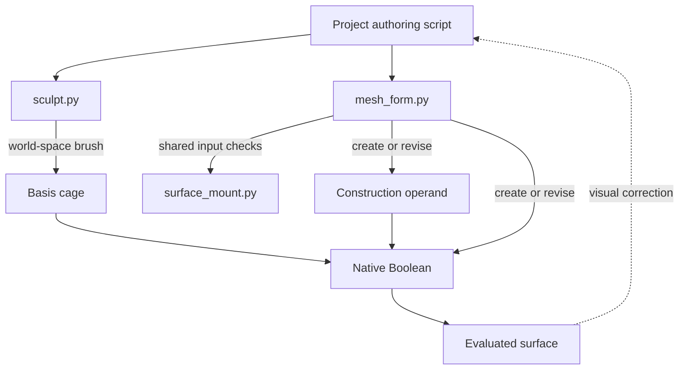

# RefAs 2 skill relationships

This map explains what the installed skill contains, who uses each element,
and what a change or removal affects. It is a repository maintenance document;
agents making assets start with the installed `SKILL.md`, not this map.

The [distribution allowlist](../../tools/verify-production-distribution.mjs)
declares the exact installed file set: Python entry/modules, six guides, the
skill entry, discovery metadata and one icon. Two `.npmignore` files also live
in the source folder but are excluded from the package. The complete npm
package adds the root README, LICENSE, package metadata and
[Node launcher](../../bin/refas.mjs). The launcher delegates to Python; the
copied Python skill can run without Node. The 2.2.0 package retains
**28 installed skill files / 32 package files**, including `sculpt.py`,
`mesh_form.py` and the focused form guide. Source-bound copied execution and
publication status are recorded in [work status](../WORK_STATUS.md).

## Relationship map

Solid arrows mean an import, command or process invocation. Dotted arrows mean
discovery or guidance read by the host agent. `production/` abbreviates
`scripts/production/`. The project-specific authoring script is outside the
installed skill.

Optional native authoring imports and their dependencies:

The independent numeric surface-binding and thickness-field imports are
described in the table below; they do not call these native construction tools.

The form operations use the same authoring script and ordinary native data.
This diagram describes their relationships; authors choose the operations and
sequence for the current shape:

The guides influence the agent's commands and scripts; Python does not execute
Markdown. The worker adds its module directory to the import path before
running the author's ordinary `bpy` script. This makes documented helper
imports available without requiring repository-only code.
The catalogue reads installed helper signatures without importing Blender or
running a project; it reports the bare imports used by native author scripts.

The two arrows between project and asset import serve distinct paths: ordinary
GLB editing loads the shared format check when needed, while saved-project
adoption calls the project runner. The lazy check avoids a startup import cycle.

Normal native iterations open the saved `.blend` through `bpy`, run the author's
`bpy` script and save/reopen the native. The GLB format check belongs to explicit
GLB intake; it does not perform modeling or inspect `.blend` geometry. Lattice
editing uses the same worker/script path and Blender's existing deformation
tools. The worker retains the cage's control data while observing the evaluated
host surface. Native control cages are distinct from the delivered mesh scope.

Explicit construction meshes use the same path: the author sets
`refas_role = "construction"` through ordinary `bpy`, and the worker retains
their source geometry and modifier relationships in the native scene. Render
evaluation keeps those dependencies while object-level `hide_render` excludes
the source surfaces. Inventory bounds/counts and GLB select the asset surfaces;
an explicit query can still inspect construction geometry. This separation
enables editable Boolean and Shrinkwrap work without a new modeling API.

## Runtime files

Paths in the first column are relative to `skills/refas/`.

| File | Purpose and actual consumers | Change or removal impact |
|---|---|---|
| [scripts/produce.py](../../skills/refas/scripts/produce.py) | Public arguments, JSON output and command dispatch. Used directly by the agent or through the npm launcher. | Keep CLI help, SKILL examples, the launcher and copied-installation checks consistent. Removing a route also requires addressing its documented workflow. |
| [scripts/production/__init__.py](../../skills/refas/scripts/production/__init__.py) | Supplies `VERSION` to the CLI. Distribution checks compare it with package/plugin identity. | Coordinate version changes with `package.json` and plugin metadata. This small file is part of the import and identity contract. |
| [scripts/production/project.py](../../skills/refas/scripts/production/project.py) | Owns references, snapshots, revisions, integrity, recovery, temporary queries and storage cleanup. CLI and saved-project importer call it; it captures explicit native/GLB inputs, shares the asset format check and starts the Blender worker with a run-local temporary directory. | Changes can affect publication or recovery even when geometry code is untouched. Follow input selection/capture, job/result contracts, failed-run evidence retention, successful diagnostics cleanup and source/revision integrity tests. |
| [scripts/production/blender_worker.py](../../skills/refas/scripts/production/blender_worker.py) | Loads the selected native or imports GLB, runs the `bpy` authoring script, saves/reopens, protects objects, observes, renders and explicitly exports. It retains native control/construction data, logs diagnostic setup/view boundaries and renders in a scoped scene/view-layer context without switching the active window scene. | Follow its job/result contract with `project.py`, source roles and modifier dependencies, control-data/protected-object state, compact queries, surface scope, delivery boundaries and actual Blender tests. Check context restoration after Python render failure; this does not establish the C-level cause of intermittent crashes. |
| [scripts/production/review.py](../../skills/refas/scripts/production/review.py) | Validates fixed camera/light specifications in both the host project code and Blender worker. | Both callers and the review guide must agree. Preserve captured settings through save/restore and test actual views where relevant. |
| [scripts/production/image_compare.py](../../skills/refas/scripts/production/image_compare.py) | Optional alpha coverage comparison. Project validates regions; the temporary Blender worker decodes captured PNGs. | Removal requires retiring `compare`, both callers, review guidance, package allowlist and comparison tests. It does not own edits or baseline approval. |
| [scripts/production/mesh_audit.py](../../skills/refas/scripts/production/mesh_audit.py) | Observes evaluated topology and anchor gaps. The worker imports its curve-tessellation discriminator at startup and calls `audit_mesh` for topology queries. Authoring scripts can also import it. | It is not optional as a whole: deleting it also breaks normal worker startup and curve instance checks. Follow worker imports, query output, topology guidance and author scripts. |
| [scripts/production/surface_mount.py](../../skills/refas/scripts/production/surface_mount.py) | Select an evaluated surface frame and rigidly place or bind a detail with explicit contact samples. Optional binding retains native Surface Deform on a three-vertex construction carrier and triangle parenting. Recess construction reuses evaluated BVH/frame functions; `mesh_form.py` reuses its mesh/numeric input checks. The worker validates saved mount relationships when present. | Keep discovery, guide, package membership, native mounting and static-delivery tests aligned. Removal breaks recess/form imports, author scripts and continuation of native projects containing checked mounts; saved Blender relationships themselves still evaluate without Python. Static export captures the rigid evaluated transform before excluding the carrier. This does not bind arbitrary flexible layers or bake animation. |
| [scripts/production/surface_patch.py](../../skills/refas/scripts/production/surface_patch.py) | Optional initial construction: sample explicit straight/Bezier profiles, create shared-boundary Coons patches, or interpolate corresponding section profiles with `build_sections`. The latter replaces repeated longitudinal Hermite interpolation and feature-column indexing. Catalogue/form/assembly guides route author scripts here. Outputs are ordinary Mesh with boundary/patch or indexed-section/named-feature selections. | Removal affects author imports, source-derived discovery, both construction examples, package membership and numeric/copied-Blender tests. Saved meshes remain directly editable without this helper; selections do not regenerate sampled spans. It does not replace source interpretation, native modifiers, rigid mounting, existing-boundary bridge or whole-asset visual review. |
| [scripts/production/sculpt.py](../../skills/refas/scripts/production/sculpt.py) | Optional `sculpt_brush`: edits an ordinary basis cage in world space with GRAB/DRAW/INFLATE/SMOOTH/FLATTEN, selected influence and symmetry. Author scripts choose brush intent and inputs; it does not sample an inverse posed/evaluated surface or enter an interactive sculpt-mode session. | Keep operation signatures, mask/symmetry semantics, native data and outside-region preservation, failure recovery, form-guide/discovery routes and package membership aligned. Removal breaks author imports; saved cage edits remain ordinary Blender geometry. Copied/native tests and fresh saved-native edits cover the admitted scope. |
| [scripts/production/mesh_form.py](../../skills/refas/scripts/production/mesh_form.py) | Optional `boolean_form` and `engrave_path`: create/revise a named native Boolean and explicit construction operand while retaining the target cage. Shares mesh/numeric input checks with `surface_mount.py`; worker construction handling retains controls and exports the evaluated asset. | Keep operand ownership, same-feature re-edit, modifier order, failure cleanup, native continuation, final-output exclusion, form-guide/discovery and package checks aligned. Removing `surface_mount.py` also breaks this import. Saved native modifiers remain editable, but new-face UVs/deformation topology and global thickness are not guaranteed. |
| [scripts/production/recess.py](../../skills/refas/scripts/production/recess.py) | Optional Blender authoring: construct/revise one named convex blind recess with an editable construction cutter and Boolean. Uses shared surface selection and verifies sampled floor/wall geometry. | Removal affects catalogue/guide imports, package allowlist and native recess tests; existing ordinary cutter/Boolean scenes remain editable. Keep static solid and sampled-thickness limits separate from cloth openings and global wall certification. |
| [scripts/production/boundary_bridge.py](../../skills/refas/scripts/production/boundary_bridge.py) | Optional native topology edit between explicit existing open chains or closed loops. Stages Blender's bridge or explicit cyclic faces with native LINEAR/SURFACE edge-ring subdivision; verifies correspondence, shared edges and source-data preservation. | Keep catalogue, assembly/garment usage, package entry and actual Blender tests aligned. Removing it breaks author-script imports, including the closed-loop keyword; accepted results remain ordinary editable cages. Object identity survives, mesh datablock replacement is explicit, and evaluated margins can change through retained modifiers. |
| [scripts/production/surface_project.py](../../skills/refas/scripts/production/surface_project.py) | Optional native Project fitting of prepared component masks, with first-hit, actual residual/displacement and failure recovery observations. Author scripts discover it through the catalogue and assembly guide. | Keep discovery, native layer examples, package allowlist and actual Blender tests aligned. Removal breaks author-script imports; saved mesh/masks and ordinary Shrinkwrap remain editable. It does not prepare geometry or replace a general constrained deformer. |
| [scripts/production/local_edit.py](../../skills/refas/scripts/production/local_edit.py) | Optional joint displacement edit with explicit region/absolute targets and frozen outside cage. Preserves optional plain Solidify → Bevel → Weighted Normal; shell pairs observe the Solidify prefix with exception-safe finish visibility restoration. Author scripts choose finite pair/ray bounds; conflicts restore coordinates. | Keep discovery, the complete assembly example, package allowlist and copied-skill/native tests aligned. Removing it breaks author-script imports but leaves saved meshes and modifiers editable. Preserve prefix correspondence separately from final finish geometry; bounded displacement is not a nonlinear solver or global thickness/collision proof. |
| [scripts/production/surface_binding.py](../../skills/refas/scripts/production/surface_binding.py) | Optional numeric authoring API for binding and transporting a section on an explicitly chosen host triangle. No core module automatically calls it. | Search documented and retained author-script imports, not only core imports. Removing it retires the supported surface-attachment recipe and its tests. |
| [scripts/production/thickness_field.py](../../skills/refas/scripts/production/thickness_field.py) | Optional stdlib graph operation approximating the greatest permitted thickness field under explicit upper, lower, pin and edge-gradient bounds. Author scripts choose whether and how to apply it. | Keep the assembly recipe, catalogue, package allowlist and numeric/native tests consistent. A field PASS does not certify evaluated shell clearance or wearing. Removing it affects retained author-script imports, not normal worker startup. |
| [scripts/production/capabilities.py](../../skills/refas/scripts/production/capabilities.py) | Read-only `authoring-capabilities` catalogue; CLI calls it, AST reads helper signatures, and task keywords route to guide paths/anchors, prerequisites and native author imports. Unmatched queries retain an empty result with next-step guidance; motion is an ordinary bpy recipe. | Keep route names, callables, input summaries and actual guide headings aligned with catalogue/copied-CLI checks. Preserve guide filesystem paths. Removal also retires the CLI route and SKILL discovery instruction; ordinary modeling does not depend on it. |
| [scripts/production/asset_import.py](../../skills/refas/scripts/production/asset_import.py) | Shares the GLB container/resource check with `run --input-glb` through a lazy project import. The `import-v1` command also uses it to capture archived bytes and call the current project path. | Both ordinary GLB editing and saved-project adoption depend on this file. Coordinate their commands, input capture, guide and tests; keep stored migration formats compatible. It is not removable solely because no 1.x migration is planned. |

## Guidance and discovery

| File | Why it exists and what it connects | Change or removal impact |
|---|---|---|
| [SKILL.md](../../skills/refas/SKILL.md) | Concise agent entry: reference features mapped to editable controls, native authoring/review loop, optional operation lookup and six on-demand guides. | Update affected command examples and guide routes. Keep development status and CI procedures in repository docs. |
| [references/production-form.md](../../skills/refas/references/production-form.md) | Whole-form priorities, spatial cage brushes, prepared solid cuts/unions and editable path engraving. Discovery routes the three new entry points here; ordinary meshes, modifiers and shared boundaries remain complementary choices. | Keep copied-skill brush/form examples, input/coordinate domains, operand ownership, feature revision and delivery limits aligned with runtime and catalogue. No tool sequence or likeness guarantee follows from the guide. |
| [references/production-assemblies.md](../../skills/refas/references/production-assemblies.md) | Native curves, shared boundaries, mounting/projection, local edits, editable recesses, pivots/lattices and surface-binding/thickness APIs. Catalogue anchors select relevant sections; existing Blender tests execute the decal revision and keep-world parenting examples. | Check SKILL/catalogue routing, construction-source and native control-cage delivery scope, garment references and helper examples. Renaming a section requires updating its catalogue anchor; changing the decal or parenting example requires its projection or animation execution check. |
| [references/production-garments.md](../../skills/refas/references/production-garments.md) | Shared cloth boundaries, sleeves, folded collars and wearing/deformation; refers to assemblies and topology. | Keep construction advice consistent with those guides and the intended character/motion scope. |
| [references/production-topology.md](../../skills/refas/references/production-topology.md) | Mesh observations, curve-to-mesh delivery, retained Shrinkwrap sources, retopology and optimization; demonstrates `inspect` and `mesh_audit`. | Follow CLI/query changes, source/output scope, helper APIs and incoming links from SKILL, garments and assemblies. |
| [references/production-review.md](../../skills/refas/references/production-review.md) | Fixed views and optional region coverage comparison. | Match `review.py`, `image_compare.py`, CLI options and actual render behavior. |
| [references/production-project.md](../../skills/refas/references/production-project.md) | On-demand native project lifecycle: GLB/native starting scenes, scene/output compatibility, preservation, reference changes, recovery and conditional saved-project adoption. | Match input selection, imported-object protection, output defaults and recovery. Keep absent authoring history and asset acceptance limits explicit. |
| [agents/openai.yaml](../../skills/refas/agents/openai.yaml) | Host discovery, displayed name, default prompt, invocation policy and the icon references. | Changes affect discovery/UX rather than Python geometry. Check the referenced icon and plugin identity. |
| [assets/icon.svg](../../skills/refas/assets/icon.svg) | Shared visual identity referenced by `openai.yaml` and repository plugin metadata. | Update both references if moved or replaced; the plugin distribution check requires the canonical icon. |
| [.npmignore](../../skills/refas/.npmignore), [scripts/.npmignore](../../skills/refas/scripts/.npmignore) | Source-only exclusions for generated Python bytecode. | Keep the source-folder allowlist and actual tarball cache-exclusion checks aligned. They are not two extra installed skill files. |

## Changes in context

This table records the affected relationships and their purpose, not a running
ledger of test totals or asset approval.

| Feature or maintenance change | Related elements | Why the relationship is needed | What to revisit if replaced or removed |
|---|---|---|---|
| Whole-form brushes and editable cuts | Catalogue/form guide → author script → `sculpt.py` / `mesh_form.py` → ordinary cage and native Boolean controls; existing worker construction/delivery path | Let the author adjust the main volume and then cut, engrave or combine needed features within flexible native modeling. | Actual brush influence/data preservation, operand ownership, feature re-edit and modifier order, native reopen/delivery/failure recovery, package membership and fresh whole-form visual evidence. The admitted #465 authoring contract does not clear #456 source fidelity. |
| Local edits with native finishes | Catalogue/assembly example → author script → `local_edit.py` → native cage and retained finish stack | Let a static finished panel receive bounded multi-handle edits without removing and rebuilding Bevel/Weighted Normal. Temporary prefix evaluation retains verified Solidify pairing. | Validate modifier identity, settings, flags and order, failure restoration, cage/data preservation and a second edit after native reopen. Final Bevel surface clearance is still a separate observation; no broader modifier support or new installed file is implied. |
| Persistent rigid surface attachment | Author script → existing contact placement → native Surface Deform carrier → triangle-parented part; worker → relationship/contact validation and static delivery realization | Keep buttons, badges and brackets attached during same-topology host edits without a handler or repeated guessed coordinates. The carrier is explicit construction geometry in native source and is excluded from GLB. | Recheck evaluated host topology, rigid scale, sampled contact, failed-bind cleanup, save/reopen, host transforms and source-driven animation rejection. Preserve existing one-shot mounting and exclude unsupported construction ancestors. Removal loses automatic continuation checks and supported export for mounted projects. |
| Initial surface construction | Author script → explicit profiles/shared boundaries → `surface_patch.py` → ordinary Mesh; existing mount places hardware on its evaluated host | Replace repeated interior-coordinate generation and independently copied adjoining boundaries during initial modeling. Keep source-specific profiles outside the installed helper. | Preserve straight/curved intent, exact boundary samples, shared indices/winding, native editability, failed-call cleanup, installed discovery and fresh initial-construction evidence. No workflow gate or live rebuild engine is introduced. |
| Corresponding section surfaces | Catalogue/form guide → authored LINEAR/BEZIER sections → `build_sections` → native Mesh with section/feature groups | Replace duplicated through-station interpolation and grid indexing while retaining explicit moving ridge/channel junctions. One-shot generation leaves ordinary native editing available. | Nonuniform station values, unequal span/interval sampling, authored-row/junction retention, C1 rail interpolation limits, float32 safety, copied-skill edit/reopen/delivery, discovery and actual original-reference form. No shape inference, controller lifetime or guaranteed reference fidelity is introduced. |
| Per-run native failure evidence and render context | Project executor → isolated temp environment → Blender; worker → existing flushed log and scoped diagnostic scene/view layer; SKILL diagnostics guidance | Preserve attributable crash output and reached render boundaries while keeping the author's active scene unchanged through diagnostic success or Python failure. | Preserve failed-run recovery/evidence, success cleanup/keep-diagnostics behavior, temporary-query lifetime, revision artifacts and actual context/pixel checks. Neither logs nor the narrower context-leak fix diagnose all intermittent C crashes. |
| Verified release package | Package/plugin identities and `production/__init__.py`; repository publication workflow → `tools/release-package.mjs` → actual archive installation and GitHub Release assets | Publish the reviewed production-only bytes with a checksum, while keeping version preparation separate from public availability. | Coordinate versions, README installation examples, release audit, package allowlist, exact-main/manual authorization and immutable asset checks. Removing the publication helper affects release delivery, not native authoring. No new installed skill file or project schema is added. |
| External animation observations | Repository-only `examples/engine-playback/run.py` → `verify_godot.gd` → Godot GLTFDocument/AnimationPlayer; engine playback tests and synthetic GLB fixtures | Compare named live nodes, skin/morph vertices and static attachments with independent native samples; retain process-timeout evidence. | Original-to-imported name association, explicit paths, SceneTree attachment updates, raw skin arithmetic, declared tolerances, runner options and README. No installed skill file or production command depends on this optional observer. |
| Selective authoring support | CLI → catalogue → source signatures; author script → optional thickness field → ordinary Solidify; SKILL and garment/assembly guides | Make existing tools discoverable and permit bounded local thickness changes across garment and panel surfaces while prioritizing whole form. | Native script import paths, graph constraints and impossible-bound rejection, evaluated surface preservation, copied install/restore, guide routes and package membership. No stage lock, new project schema or collision-repair claim is introduced. |
| Native construction meshes | Existing project/worker → ordinary `bpy`; SKILL, assemblies and topology guides | Keep Boolean cutters and projection sources editable in the native while final surface counts, framing and GLB omit the source surfaces. Retain dependencies for render/export evaluation and protection. | Explicit role and modifier target fingerprints, scene/view-layer scope, helper ancestry, selected-source queries, native restore, final-geometry counts and installed static export. Removing the role requires resolving saved helper-dependent projects and both authoring recipes; hiding arbitrary meshes is not an equivalent replacement. |
| Editable native lattices | Existing CLI/project → worker → ordinary `bpy` script; SKILL and assembly guide | Retain a Blender deformation cage and modifier for continued local shape edits. Record its control data while rendering and inspecting the evaluated host geometry; no new command, module or deformation algorithm. | Grid/interpolation/controls/group weights/shape keys/animation fingerprints, protected state, in-scene and active-view-layer dependencies, compact queries and exact restore. Delivery rejects every remaining scene lattice and does not auto-bake animation. Removing support would retire continued native cage editing and its installed-use tests. |
| Direct GLB authoring input | CLI → project → worker; project → `asset_import` format check; SKILL and import guide | Start a useful `bpy` edit from an ordinary self-contained GLB without a manual native conversion or saved-project format. The original input is captured and subsequent edits continue the native revision. | Mutually exclusive complete-scene inputs, captured GLB identity, embedded-resource requirements, imported-object protection, native/delivery defaults, restore and existing Python positional calls. Reuses the existing modules and adds no report format. |
| Editable native curves | Worker inventory/protection/rendering; worker → `mesh_audit`; SKILL, assemblies and topology guides | Keep curve controls editable while observing their evaluated surface. Blender's implicit curve surface must be distinguished from genuine instances. | Curve state preservation, evaluated bounds, instance rejection, explicit mesh delivery and guidance. No additional installed module was introduced. |
| Topology summaries and requested details | CLI → project → worker → `mesh_audit`; SKILL and topology guide | `inspect --topology` gives summary facts. `--topology-details` requests the bounded location/component records when needed and implies topology. This reduces routine response size without changing the underlying defect observations. | CLI defaults, explicit detail selection, Python API compatibility, worker response shape and source-integrity/cleanup guarantees. Existing Python callers retain their detailed default unless they explicitly request summary output. |
| CI and relationship reporting | Repository workflows, tests, distribution checks and this map | Normal CI uses Node 22/24; retained legacy JIT/deep suites have separate execution conditions. The map makes dependencies and removal impact inspectable. | Workflow triggers/conditions and their required gates. These changes do not add a Blender runtime dependency or an installed skill file. |

Both managed-project and standalone queries follow the same worker route.
Their temporary files, input hash checks and `persisted: false` result belong
to the project/query contract. Choosing more or fewer details is not permission
to save a new revision, convert the source or relax an observation.

## Existing checks to follow

Validation lives outside the installed skill. Use the checks that exercise
the changed relationship; a documentation edit does not require another asset
or render merely to update this map.

| Relationship | Existing verification |
|---|---|
| Installed file set and allowed internal links | [Distribution allowlist](../../tools/verify-production-distribution.mjs), [distribution tests](../../tests/production-distribution.test.mjs) |
| Exact release archive and immutable public assets | [Release package helper](../../tools/release-package.mjs), [publication tests](../../tests/release-package.test.mjs), [manual publisher](../../.github/workflows/publish-release.yml); existing archive-install check below |
| npm launcher and independent Python copy | [Packed-install check](../../tools/verify-packed-install.mjs), distribution tests above |
| Discovery, icons and plugin identity | [Plugin checker](../../tools/verify-plugin-distribution.mjs), [plugin tests](../../tests/plugin-distribution.test.mjs) |
| CLI/project, queries, integrity and recovery | [Project tests](../../tests/test_production_project.py), [resource tests](../../tests/test_production_resources.py), [native tests](../../tests/test_production_native.py) |
| Worker behavior, scoped render context and curves | [Blender tests](../../tests/test_production_blender.py), [curve tests](../../tests/test_production_curves.py), copied-skill native render comparison identified in [work status](../WORK_STATUS.md) |
| Native lattice controls, evaluated host and delivery boundary | [Lattice tests](../../tests/test_production_lattices.py), existing project recovery and distribution checks above |
| Native construction sources, Boolean/Shrinkwrap evaluation and final output scope | [Construction tests](../../tests/test_production_construction.py), installed editing/delivery/protection/restore and actual matched views |
| Fixed review specification | Project capture/restore and validation tests; actual fixed-view Blender tests above |
| Animation and consumer execution | [Animation tests](../../tests/test_production_animation.py), [engine playback tests](../../tests/test_production_engine_playback.py) |
| Mesh observations | [Mesh-audit tests](../../tests/test_production_mesh_audit.py), native and curve query tests above |
| Rigid mounting and native surface attachment | [Blender mounting tests](../../tests/test_production_surface_mount.py), [copied-skill native/static-delivery tests](../../tests/test_production_surface_mount_delivery.py), actual corrected garment and host-edit observations outside Git |
| Initial shared-boundary and corresponding-section surfaces | [Profile/interpolation and actual copied native construction tests](../../tests/test_production_surface_patch.py), helper-free native edit/reopen and fresh source-based construction outside Git; exact section guide example independently executed |
| Spatial brushes and editable mesh/path operations | [Copied-skill sculpt tests](../../tests/test_production_sculpt.py), [native mesh/path tests](../../tests/test_production_mesh_form.py), actual reopen/re-edit/failure/delivery and fresh whole-form evidence identified in [work status](../WORK_STATUS.md) |
| Optional blind recess construction | [Blender and installed-native tests](../../tests/test_production_recess.py), source-bound car intake study outside Git |
| Native connected boundary transitions | [Copied-skill Blender tests](../../tests/test_production_boundary_bridge.py), source-bound collar/lapel and fender/body comparisons plus whole-coat closed armholes outside Git |
| Bounded native surface projection | [Copied-skill Blender tests](../../tests/test_production_surface_project.py), actual prepared sleeve-layer fitting and failed-projection recovery outside Git |
| Joint local displacement with hard handles and bounded observations | [Copied-skill Blender tests](../../tests/test_production_local_edit.py), garment/car local edits, failed-bound recovery and native continuation outside Git |
| Optional surface-binding API | [Numeric tests](../../tests/test_production_surface_binding.py), [installed Blender tests](../../tests/test_production_surface_blender.py) |
| Optional thickness field and native application | [Independent graph-oracle tests](../../tests/test_production_thickness_field.py), [copied-skill Blender/restore test](../../tests/test_production_thickness_blender.py) |
| Installed authoring discovery | [AST and copied-CLI tests](../../tests/test_production_capabilities.py), packed-install check above |
| Direct GLB input selection, capture and continued editing | [Resource tests](../../tests/test_production_resources.py), actual Blender/installed-input checks above |
| 1.x asset adoption | [Import tests](../../tests/test_production_import.py), Blender import tests above |
| Repository CI execution | [Normal CI](../../.github/workflows/ci.yml), [production CI](../../.github/workflows/production.yml), [Deep QA](../../.github/workflows/ci-deep.yml) |

The retained [`legacy/v1/`](../../legacy/v1/) code supports historical comparison
and regression checks. It is outside the production package and is not a
dependency of the current importer. Likewise, repository CI validates the
distribution but is not part of the installed modeling workflow.

## Keeping the map useful

When a feature changes an import, public command, authoring helper, guide route
or installed file, update the corresponding arrow and table row in the same
change. Reports should show the relevant relationship, the reason for the
change and its effect on callers, rather than repeat the entire file inventory.

Before removing an element, identify its callers, documented commands/recipes,
retained author-script imports, packaging entries and tests. An absent core
import does not establish that an optional authoring API is unused. Remove or
replace those references together only when the supported use is intentionally
retired. Keep user project history and prior assets separate from source cleanup.
